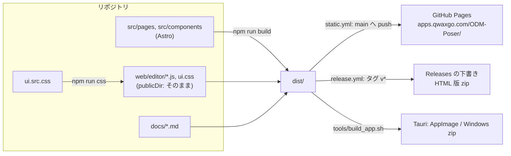
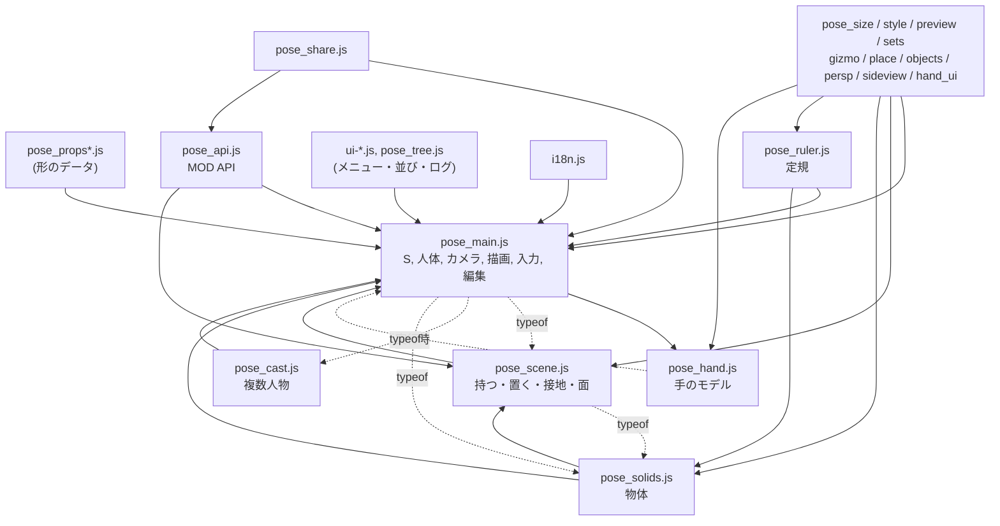
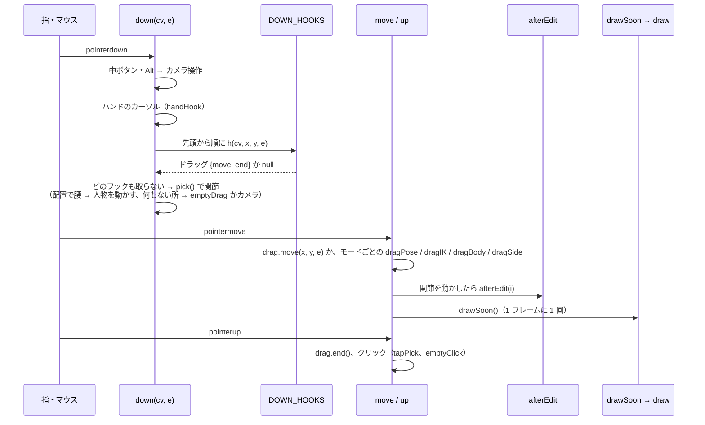
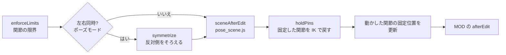
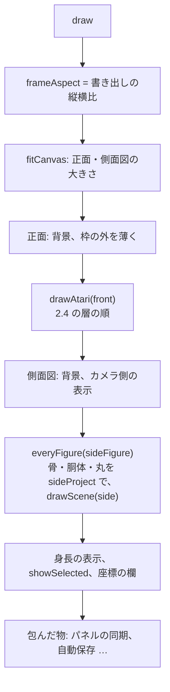
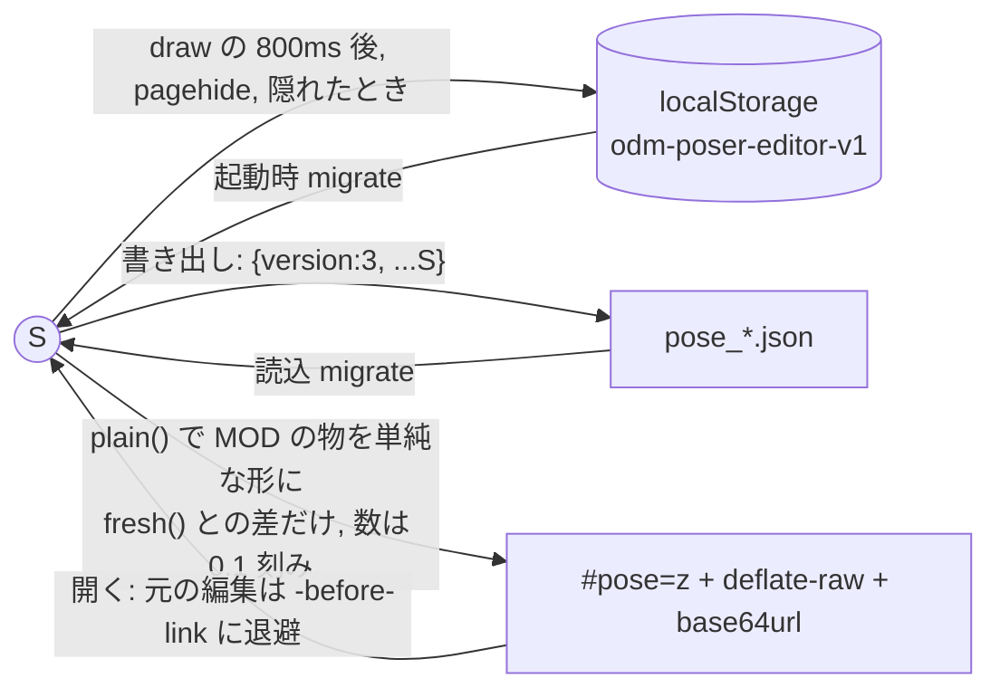

# 設計書：立体人形装置（ODM Poser）エディタの構成と実装

English: [ARCHITECTURE.md](ARCHITECTURE.md)

## 0. この文書について

- **目的**: リファクタリングの前に、今ある機能と実装の仕組みを、人間が読んで理解できるようにまとめます。機能は変えません。この文書は「今どうなっているか」を書き、最後の章（10 章）に、リファクタリングで守るべき約束と、難しい所を挙げます。
- **読む人**: JavaScript は分かるが、このコードは初めての開発者。
- **書いた時点**: v0.2.0 の開発中（2026-11-11。同じ日に手と指の作り直しを反映）。コードの場所は、行番号ではなく関数名・変数名で示します（行番号はすぐずれるため）。
- **ほかの文書との分担**:
  - [HANDOFF.md](HANDOFF.md): 作業の引き継ぎメモ（持ち主の決まりごと、未解決の項目）。
  - [MODDING-JA.md](MODDING-JA.md): MOD API の利用者向けの説明。
  - [MANUAL-JA.md](MANUAL-JA.md) ほか: 利用者向けの使い方。
  - [AGENTS.md](../AGENTS.md): UI の作り方と確かめ方（melta UI）。
- この文書はサイトの「ドキュメント」には出ません（`src/content.config.ts` が公開するファイルを名前で選んでいるため）。

### 用語

| 用語 | 意味 |
|------|------|
| アタリ | 線と丸で描いた人体のラフ。エディタの描画そのもの |
| 人物（figure） | 21 個の関節を持つ人形。複数置ける |
| 小物（item / thing） | 手に持つ・身に着ける・単体で置く物。`S.items` |
| 物体（solid） | 箱・角柱・円柱・壁・床板・天井などの図形。`S.solids` |
| 環境（env） | 地面（床）の高さと接地の設定。`S.env` |
| 正面（front） | カメラから見た図。キャンバス `#front` |
| 側面図（side） | 正投影の横からの図。キャンバス `#side` |
| モード | ポーズ・体格・カメラ・配置。内部名は `pose` / `body` / `persp` / `place`（カメラは `persp`） |
| タブ（menu） | 右の操作欄の 1 ページ。`section[data-menu="…"]` |

## 1. 全体像

### 1.1 何をするアプリか

ブラウザで動く疑似 3D のポーズエディタです。人物の関節を 3D の座標で持ち、Canvas 2D に線と丸で描きます。小物・物体・床・定規を置いて構図を作り、次の物を書き出します。

- アタリ画像
- OpenPose 画像（COCO 18 点と両手 21 点ずつ）
- 構図の画像
- ポーズのファイル（JSON）
- 編集データ入りの共有リンク

WebGL は使っていません。描画はすべて自前の投影と Canvas 2D の線です。

### 1.2 動く場所と、そこから来る制約

| 動く場所 | 中身 | 制約 |
|---------|------|------|
| サイト（GitHub Pages） | Astro で作った静的サイト。`/ODM-Poser/editor/` | サーバー側の処理はない |
| アプリ（PWA） | 同じページを `sw.js` で保存し、オフラインでも開く | — |
| HTML 版（Releases の zip） | ディスクから開く（`file://`） | **ES モジュールと、自分のファイルの fetch は使えない**。すべてクラシックスクリプト |
| 実行ファイル（Tauri） | `src-tauri/`。保存はアプリの命令 `save_file` | `window.ODM_APP_SAVE` で保存を差し替える |
| ComfyUI ブリッジ（別リポジトリ） | HTML 版を中に持つ | `../mods.js`、`../mods/`、MOD API、状態の形式に頼っている |

このほかに、コードの書き方の決まりがあります。

- `?.` と `??` を使いません。構文の確認に使う esprima が読めないためです。
- 書き出したファイルは CC0、ツールは MIT です。他人の権利のある素材は入れません（HANDOFF.md）。

### 1.3 リポジトリの構成

| 場所 | 中身 |
|------|------|
| `src/pages/editor/index.astro` | エディタのページ。スクリプトの読み込み順もここで決まる |
| `src/components/editor/*.astro` | エディタの HTML（Stage = 図、Panel* = 操作欄の各部）。props のない素の HTML |
| `web/editor/*.js` | エディタの本体（約 11,700 行、31 ファイル）。Astro の `publicDir` としてそのまま配信 |
| `web/editor/ui.src.css` → `ui.css` | 見た目。Tailwind CSS 4 で生成（`npm run css`）。`ui.css` は手で直さない |
| `web/editor/sw.js`, `manifest.webmanifest` | PWA |
| `src/pages/docs/`, `src/lib/docs.ts`, `docs/*.md` | 利用者向けドキュメントのページ |
| `src-tauri/` | アプリ（Rust）。MOD のフォルダを `odmmods://` で配る |
| `tools/` | ビルド・確認の道具（`lint_ui.py`, `dist_server.py`, `make_release_html.py` ほか） |
| `design/melta-ui/`（サブモジュール）, `design-system/` | デザインシステム melta UI と、このプロジェクトの上書き |
| `mods/` | 利用者の MOD（README だけを管理） |

### 1.4 ビルドと配信



- `index.astro` は、ビルドごとに変わる印 `?v=…` を各スクリプトの後ろに付けます。古いキャッシュを避けるためです。
- ページは日本語で書かれています。英語は `i18n.js` が表示のときに置き換えます（6.4）。

## 2. 実行時の構成

### 2.1 クラシックスクリプトと、共有するグローバル

エディタのスクリプトは、`index.astro` の順に `<script is:inline>` で読まれます。モジュールの仕組みはなく、**すべてのファイルが 1 つのグローバルの名前空間を共有します**。

- `pose_main.js` は即時関数（IIFE）に包まれていません。トップレベルの約 270 個の名前（`S`, `J`, `IX`, `draw`, `project` …）がそのままグローバルになります。
- `pose_scene.js`、`pose_cast.js`、`pose_solids.js`、`pose_style.js`、`pose_ruler.js` も、トップレベルに関数を置きます。
- それより後のファイルは、たいてい IIFE に包まれていて、外へは `window.ODM…` だけを出します。

| 順 | ファイル | 行数 | 役割 | 外へ出す主な物 |
|---:|---------|----:|------|--------------|
| 1 | `ui.js` | 119 | melta UI のクラスを各コントロールに付ける（MutationObserver） | `ODMUI`（一部） |
| 2 | `pose_props.js` | 457 | 小物の形のデータ（手で作った図形） | `PROP_CATS`, `PROPS` |
| 3 | `pose_props_more.js` | 271 | 小物の追加分（効果、身に着ける物、単純な図形） | （`PROPS` に足す） |
| 3a | `pose_hand.js` | 191 | 手のモデル：手の形、指の関節、21 点、描画（5.12）。**`pose_main.js` より前に読むが、中の関数は `pose_main.js` の名前を実行時に使う** | `HANDS`, `FINGERS`, `handShape3D`, `drawHand`, `fingerSel` … |
| 4 | `pose_main.js` | 2301 | 中心：人体・状態 `S`・カメラと投影・描画・入力・編集の流れ・パネルの基本・ファイル | 約 280 個のグローバル |
| 5 | `pose_scene.js` | 1291 | 床と接地、持つ・着ける・置く、乗る、つかまる、ワイヤー、面に立つ | `drawScene`, `sceneAfterEdit`, `partSets` … |
| 6 | `pose_cast.js` | 185 | 複数の人物（入れ替えて描く） | `everyFigure`, `withFigure`, `onlyFigure` |
| 7 | `pose_sets.js` | 135 | ポーズ・体格の記憶（ブラウザに保存） | — |
| 8 | `pose_solids.js` | 386 | 物体（メッシュ、描画、接地、面に着ける） | `solidMesh`, `groundSolid`, `SOLID_KINDS` … |
| 9 | `pose_size.js` | 302 | サイズ（部位の長さ、頭の形、小物の 3 軸） | — |
| 10 | `pose_style.js` | 441 | 線の色とオーラ | `partColor` を使う描画, `AURA_KINDS` |
| 11 | `pose_preview.js` | 201 | 置く前のプレビュー | — |
| 12 | `pose_ruler.js` | 444 | パース定規とガイド図形、スナップ | `drawRuler`, `vanish`, `snapSolid` … |
| 13 | `pose_gizmo.js` | 455 | 3 軸ハンドル | `ODMGizmo`, `ODMGizmoTargets` |
| 14 | `pose_place.js` | 538 | 設置のタブ（置く物の一覧、置いた物の位置・回転・大きさ、面に接地） | `ODMGhost`, `ODMPlaceGuide` |
| 15 | `pose_objects.js` | 448 | 物体と小物を 1 つの選択として扱う（複数選択、切り取り・貼り付け、カーソル、支点） | `ODMObj` |
| 16 | `pose_persp.js` | 302 | パースの誇張（支点、一時的なカメラ） | `ODMPxMark` |
| 17 | `pose_sideview.js` | 157 | 側面図のカメラ | — |
| 17a | `pose_hand_ui.js` | 256 | 指の操作：丸の選択・ドラッグ、3 軸ハンドル、パネル、自分の手の形、手と指の大きさ | `ODMHand` |
| 18 | `i18n.js` | 689 | 日本語→英語の置き換え | `ODMPoserI18n` |
| 19 | `ui-icons.js` | 62 | メニューのアイコン（SVG） | `ODMICONS` |
| 20 | `ui-menu.js` | 201 | 操作欄のメニュー（3 階層）とタブ | `ODMUI.showMenu` ほか |
| 21 | `ui-figure.js` | 159 | 全身図（どこを編集中か） | — |
| 22 | `pose_tree.js` | 110 | 管理のタブ（シーンの一覧） | — |
| 23 | `ui-help.js` | 171 | 操作のヒント | — |
| 24 | `ui-log.js` | 107 | 作業ログ | — |
| 25 | `../mods.js` | — | MOD の一覧（ページの外。ホストが配る） | `ODM_POSER_MODS` |
| 26 | `pose_api.js` | 584 | MOD API と MOD の読み込み | `ODMPoser`（旧名 `SymbolicPose`） |
| 27 | `pose_share.js` | 313 | SNS への投稿と `#pose=` のリンク | — |
| 28 | `ui-layout.js` | 130 | 操作欄の並び（ラベルと欄の組） | — |
| 29 | `ui-pane.js` | 135 | 図と操作欄の境目、モードの列 | — |
| 30 | `ui-sheet.js` | 117 | スマホ・縦のタブレットの並び（下のバーとシート） | — |

`i18n.js` の後のファイル（`ui-*.js`、`pose_api.js` …）は、`i18n.js` があるものとして書けます。前のファイルは、訳の表を `window.ODMPoserI18nEarly` に積んでおき、`i18n.js` が読み込まれたときに取り込みます。

### 2.2 依存の向き

矢印は「使う」向きです。ほとんどのファイルが `pose_main.js` の名前を直接使います。



点線は `typeof X === "function"` で、あれば呼ぶ所です。`pose_main.js` は、後から読まれる `drawScene`、`sceneAfterEdit`、`everyFigure`、`solidMesh`、`pixelRay` などを、この形で呼んでいます。

### 2.3 機能を足す 4 つのやり方

このコードでは、ファイルが前のファイルに機能を足すとき、次の 4 つのやり方を使います。リファクタリングでは、とくに 1 つ目を把握してください。

1. **関数の上書き（ラップ）**: 前のファイルの関数を、変数に取っておいて置き換えます。
   ```js
   { const atari0 = drawAtari;
     drawAtari = function(ctx, W, H, opts = {}){ atari0(ctx, W, H, opts); /* 自分の描画 */ }; }
   ```
   関数宣言は書き換えられるので、置き換えた後の呼び出しは、すべて新しい関数に行きます。**呼ばれる順は、ファイルの読み込み順で決まります。**
2. **フックの配列**: `DOWN_HOOKS`（押したとき）と `WHEEL_HOOKS`（ホイール）。`pose_main.js` の `down()` が先頭から順に呼び、最初にドラッグの物 `{move, end}` を返したものが入力を取ります。`unshift` で先頭に入れたものが先です（2.4 の表）。
3. **`typeof` で、あれば呼ぶ**（2.2 の点線）。
4. **`window.ODM…` のオブジェクト**: `ODMObj`（選択）、`ODMGizmo` と `ODMGizmoTargets`（3 軸ハンドルの対象を足す口）、`ODMUI`（メニュー）、`ODMPxMark`（支点の印）、`ODMGhost`（置く前の物）、`ODMPoser`（MOD API）。

ほかに、変数の差し込み口もあります。`pose_main.js` の `handHook`、`emptyDrag`、`emptyClick`、`tapClick`、`gizmoHolds` は空のまま置かれていて、`pose_objects.js` と `pose_gizmo.js` が中身を入れます。

### 2.4 上書きの連鎖の一覧

**`drawAtari(ctx, W, H, opts)`**: 1 枚の絵（正面・書き出し・スマホの小さい図）に、人物と、その周りの物を描きます。次の 11 ファイルが重ねて包んでいます。外側（後から読んだ物）から呼ばれ、中へ進みます。

| 外側から | ファイル | 中を呼ぶ前 | 中を呼んだ後 |
|---:|---------|-----------|------------|
| 1 | `pose_api.js` | MOD の `drawBehind` | MOD の `draw` |
| 2 | `pose_persp.js` | — | 支点の印（正面・書き出し以外） |
| 3 | `pose_objects.js` | — | 支点・グループの印（配置モード） |
| 4 | `pose_place.js` | — | 置く前の物（設置のタブ） |
| 5 | `pose_gizmo.js` | — | 3 軸ハンドル |
| 6 | `pose_ruler.js` | 定規（書き出し以外） | — |
| 7 | `pose_preview.js` | — | 装備・設置のプレビュー |
| 8 | `pose_style.js` | 全員のオーラ（炎・光は後ろ） | プラズマ（前） |
| 9 | `pose_solids.js` | 物体 | — |
| 10 | `pose_cast.js` | — | 人物ごとに中を呼ぶ（奥から。2 人目以降は環境を描かない） |
| 11 | `pose_main.js`（もと） | `withPX(figPX(), …)` で誇張のカメラにして `drawFigure` | — |

`drawFigure` の中で、`drawScene`（床・小物・ワイヤー。これも `pose_solids.js` と `pose_api.js` が包む）を呼びます。**重なりの順（何が上に描かれるか）が、ファイルの読み込み順と包み方で決まっている**ことに注意してください。

**`draw()`**: 画面の全体を描き直します。中身は 4.4 の流れです。13 ファイルの 18 か所が包み、それぞれ自分のパネルの表示をそろえます。

| ファイル | 包んでしていること |
|---------|-----------------|
| `pose_main.js`（最後） | 800ms 後に `saveLocal()`（ブラウザへ自動保存） |
| `pose_size.js`（2 か所） | 頭の形の欄、サイズの数字 |
| `pose_style.js` | 色の欄の小物の一覧 |
| `pose_place.js` | 設置の欄（タブが開いているとき） |
| `pose_objects.js`（3 か所） | 範囲選択の枠、カーソル、編集ボタンの有効・無効 |
| `pose_persp.js`（2 か所） | 側面図の支点の印、パースの欄 |
| `pose_sideview.js` | 側面図の欄 |
| `pose_hand_ui.js` | 手の大きさ・指の長さの欄（体格のタブが開いているとき） |
| `ui-figure.js` | 全身図 |
| `pose_tree.js` | 管理の一覧 |
| `ui-layout.js`（2 か所） | 並びの絵、数値とスライダーの対 |
| `ui-pane.js` | 境目・列 |
| `ui-sheet.js` | スマホのシートの小さい図 |

つまり **`draw()` は「描画＋パネルの同期＋自動保存」** を兼ねています。

**`syncUI()`**: `S` が丸ごと入れ替わった後（元に戻す・読込・リンク・作業ログ）に、パネルを `S` に合わせます。包んでいるのは `pose_main.js`（カメラの記憶）、`pose_scene.js`、`pose_cast.js`、`pose_solids.js`、`pose_style.js`、`pose_ruler.js`、`pose_tree.js`、`pose_api.js`（MOD の `sync`）です。

**そのほかの上書き**

| 関数 | 包むファイル | 目的 |
|------|------------|------|
| `afterEdit` | `pose_api.js` | MOD の `afterEdit` |
| `drawOpenpose`, `applyPreset` | `pose_cast.js` | 人物ごと／立つ場所を保つ |
| `camHeld`, `camLockUI`, `exportCanvas`, `upgradeState` | `pose_persp.js` | 一時的なカメラ（ロック中でも動かす、書き出しはロックしたカメラで） |
| `emptyClick`, `tapClick` | `pose_objects.js` → `pose_persp.js` | 何もない所のクリック、支点の選択を外す |
| `down` | `pose_sideview.js` | 側面図の回転・移動・支点のドラッグ |
| `remember`, `say`, `toast` | `ui-log.js` | 作業ログに書く |
| `addItem`, `addSolid` | `pose_preview.js` | 置く前に決めた大きさで置く |
| `showSelected` | `pose_hand_ui.js` | 関節のパネルと一緒に、指の欄をそろえる |

**`DOWN_HOOKS` に入れているもの**: `pose_main.js`（自動のモード切り替え）、`pose_scene.js`、`pose_solids.js`、`pose_ruler.js`、`pose_gizmo.js`、`pose_objects.js`、`pose_cast.js`、`pose_persp.js` が入れています。`pose_hand_ui.js` の指のフックは、3 軸ハンドルのフック（`ODMGizmo.downHook`）の**すぐ後ろ**に `splice` で入ります（輪を押したとき、輪の中にある指の丸に取られないため）。ほかに、一時的に入れるもの（面をクリックして立つ、面に接地）と、MOD の `pointerDown`（最後の 1 つの前に入る）があります。

## 3. 状態（データモデル）

### 3.1 `S`：編集している内容のすべて

`let S = fresh();`（`pose_main.js`）が、保存・元に戻す・共有の単位です。**`S` は丸ごと入れ替わります**（元に戻す、読込、共有リンク、作業ログ、MOD の `loadPose`）。ほかのファイルは `S` やその中の物を変数に取っておかず、毎回 `S.…` から読んでください（取っておいた古い物を書き換える不具合が実際にありました）。

| 項目 | 中身 | 主に扱うファイル |
|------|------|----------------|
| `P` | 関節の 3D 座標 21 個（cm、y が上、人物は +z を向く）。順は `J` | ほぼすべて |
| `R` | 関節の丸の半径（cm） | main, size, scene |
| `twist` | 関節ごとのねじり（度） | main, gizmo |
| `hands` | `{r, l}` 手の形の名前（`HANDS`）。持つ物・MOD・古いファイルもこれを変える | hand, scene |
| `fingers` | `{r, l}` 調整した指 `{from, a, name}`。`hands` がまだ `from` の間だけ使う（5.12） | hand, hand_ui |
| `fingerLen` | 指の長さの割合 5 つ（0.85〜1.15、両手共通） | hand, hand_ui, sets |
| `head`, `headShape` | 頭（旧）、頭の形（伸び縮み） | main, size |
| `body` | 全身の回転 `{yaw, pitch, roll}` | main |
| `pins` | `{関節番号: [x, y, z]}` 固定した関節 | main, scene |
| `shape`, `scale`, `sex`, `torso3d` | 肩・股の立つ向き、旧スケール、性別、胴体を立体で描くか | main, sets |
| `items` | 小物（5.6） | scene ほか多数 |
| `solids` | 物体（5.7）。壁・天井も物体 | solids ほか多数 |
| `env` | `{floor, floorY, ground, attach, show, …}` 床と接地。`wall` / `ceiling` は古い形（`migrateEnv` で物体に変わる） | scene |
| `wire` | ワイヤーアクション `{on, joint, anchor, length}` | scene |
| `stand` | 人物が立っている面 `{p, n}`（壁・天井・斜面） | scene |
| `auras`, `colors` | オーラ、線の色 | style |
| `cam`, `center` | カメラ `{lens, yaw, pitch, roll, zoom}` と注視点 | main |
| `cams`, `camLock`, `camPeek` | 記憶したカメラ、固定、一時的なカメラ | main, persp |
| `persp` | パースの誇張 `{pivot, k, mark}` | persp |
| `sideView` | 側面図のカメラ `{from, key, joint, yaw, pitch, zoom, pan}` | sideview |
| `ruler` | パース定規 | ruler |
| `others`, `figId`, `figName` | ほかの人物（`FIG_KEYS` の項目を持つ）、編集中の人物の番号と名前 | cast |
| `mods` | `{MOD の id: その MOD のデータ}` | api |

### 3.2 人体

- `J`: 関節の名前 21 個。`pelvis, waist, chest, neck, head, r_shoulder, r_elbow, r_wrist, l_shoulder, l_elbow, l_wrist, r_hip, r_knee, r_ankle, r_toe, l_hip, l_knee, l_ankle, l_toe, r_hand, l_hand`。手（`r_hand` / `l_hand`）が最後なのは、19 関節の古いファイルが末尾に足すだけで読めるようにするためです（`upgradeState`）。
- `IX[名前]` が番号、`PARENT[i]` が親、`KIDS[i]` が子、`MIRROR[i]` が左右の反対側です。
- `REST` と `REST_R` は立ち姿の座標と半径、`SEX_BODY` は性別ごとの骨の長さと幅です。
- 骨の長さは、座標の差から毎回求めます（別には持っていません）。

### 3.3 `S` の外にある状態

| 状態 | 場所 | 意味 |
|------|------|------|
| `sel` | pose_main.js | 選んでいる関節の番号（-1 なし） |
| `fingerSel` | pose_hand.js | 選んでいる指の関節 `{side, n, j}`。`sel` がその手の手首か手のときだけ有効 |
| `mode` | pose_main.js | 今のモード（`pose` / `body` / `persp` / `place`） |
| `scSel` | pose_scene.js | 選んでいる小物の番号（`S.items` の添字） |
| `soSel` | pose_solids.js | 選んでいる物体の番号（`S.solids` の添字） |
| 選択（`"s3"` / `"i2"` のキーの集合） | pose_objects.js（`ODMObj`） | 配置モードの選択（複数可） |
| `sel`（設置） | pose_place.js（IIFE の中） | 設置のタブで選んでいるキー |
| `drag` | pose_main.js | 今のドラッグ |
| `PX`, `frameAspect`, `occFrozen`, `occMemo` | pose_main.js | 描画の途中だけ使う値・覚えておく値 |
| 書き出しの設定 | DOM の入力欄（`#W`, `#H`, `#ratio`, `#atariMode`, `#cm*` …） | `exportSize()` などが欄から直接読む |
| 表示の設定 | DOM と localStorage（8 章） | 関節の限界、左右同時、カーソル … |

選択の状態がいくつかに分かれていることと、添字（何番目か）で指していることは、10 章の難所です。

### 3.4 保存の形式と互換

- ファイルは `{version: 3, ...S}` です（`saveJson`）。読むときは `migrate(d)` で古い形を直してから、`Object.assign(fresh(), d)` で足りない項目を初期値で埋めます。
  - 18 関節（ウエストのない v1）
  - `head.yaw`（v2）→ 頭のねじり
  - 19 関節（手のない形）→ `upgradeState`
- `syncUI()` も最初に `upgradeState(S)` を呼びます。
- 小物の古い大きさ（`len`, `thick`）は `stretchOf` が読み、編集したときに `foldStretch` が `stretch` に直します。
- 共有リンクは、`fresh()` と違う項目だけを入れます（4.6）。

## 4. 主な処理の流れ

### 4.1 起動

1. `pose_main.js` が読まれます。
   - `S = fresh()`
   - 入力・パネルのイベントをつなぐ
   - 書き出しの大きさと構図の設定を `localStorage` から戻す
   - `localStorage` の `odm-poser-editor-v1` から `S` を戻す（`migrate`）
   - `syncUI(); draw();`
2. 後のファイルが順に、包む・フックを足す・パネルを作る（`innerHTML`）、をします。多くはその場で `draw()` も呼びます。
3. `i18n.js` が言語を決めて、ページ全体を訳します。それ以降に足された要素は、MutationObserver で訳します。
4. `ui-menu.js` が、パネルの `section` を見出しごとに分けて、タブに振り分けます（要素を動かすだけで、作り直しはしません）。
5. `pose_api.js` が `window.ODM_POSER_MODS` の MOD を読み込みます（`?nomods` で読み込まない）。
6. `pose_share.js` が、アドレスの `#pose=` を開きます。
7. `ui-layout.js`、`ui-pane.js`、`ui-sheet.js` が並びを整えます。

### 4.2 入力：押す→フック→ドラッグ

マウス・タッチ・ペンは、すべて Pointer Events で受け、`evMods()` で同じ形の物にそろえます。画面の「Shift」「固定」ボタン（`VMOD`）、ペンのボタン、右クリックは Shift / Alt として扱います。



- 2 本指（つまむ・動かす）は、`pose_main.js` の `pinch` が別に受けます。側面図の 2 本指は `pose_sideview.js` が受けます。
- タッチで関節を動かすには、先にタップで選びます（間違えて動かさないため）。
- 3 軸ハンドルが出ている間（`gizmoHolds()`）は、関節や物を直接ドラッグしても選ぶだけです。
- 編集の前には `remember()` を呼んで、元に戻すための記録を取ります。フックがドラッグを返したときは、`down()` が呼びます。

### 4.3 編集の流れ（afterEdit）

関節を動かす編集は、最後に `afterEdit(moved)` を通ります。



`sceneAfterEdit(moved)` の中は、次の順です。

1. `followItems`: 持っている物が手についていく
2. ワイヤー: 長さを超えたら全身を引き戻す
3. 配置で腰を面に近づけたら、その面に立つ（`attachNear`）
4. 面に立っていれば、面に乗せ続ける（`onPlane`）
5. 立っていなければ、接地（`groundLift`: 床や物体の上面に、めり込まない／いつも着ける）

### 4.4 描画（draw）



- 書き出しも同じ `drawAtari` を使い、`opts.export` で、画面だけに出す物（定規、ハンドル、印、プレビュー）を抜きます。
- 色はキャンバスでも CSS の変数（`cssVar("--figure")` など）から読むので、ダークテーマに付いてきます。
- 隠れ線の破線（5.4）のために、`occFrozen` に、全員分の「物を隠す物」を先に集めておきます。

### 4.5 元に戻す・作業ログ

- `remember()` は、`JSON.stringify(S)` を `history` に積みます（最大 80 件。直前と同じなら積まない）。`undo` / `redo` は文字列を `JSON.parse` して `S` を入れ替え、`syncUI(); draw();` します。
- スライダーは、押したとき（`pointerdown`）とキー操作のときに `remember()` します。1 回のドラッグが 1 ステップになります。
- `ui-log.js` は `remember` / `say` / `toast` を包んで、操作のたびに、時刻・メッセージ・`S` の写しを残します（最大 100 件、ブラウザに保存）。どの時点にも戻せます。

### 4.6 保存・読込・自動保存・共有リンク



- 共有リンクの中身は `{v: 1, s: 差分, mods: [公式 MOD の URL]}` です。リンクに入る MOD は公式の物（GitHub の qwaxgo）だけです。ほかの MOD の小物や物体は、単純な形に置き換えます（`plain`）。
- `#` の後ろはサーバーに送られません。そのため、SNS のカードは構図ごとの画像にできません。投稿に画像を付けるときは、スマホでは共有メニューに渡し、パソコンではクリップボードにコピーします（`shareImage`）。

### 4.7 書き出し

- `exportSize()` が欄 `#W` / `#H` を読みます。`exportCanvas()` は、端末が描ける大きさまで縮めたキャンバスを作ります（iOS の上限など）。
- アタリ画像は `render("atari")` です。`#atariMode` が「構図」なら、物体と環境も描きます。OpenPose 画像は `render("openpose")`、構図の画像は `compCanvas()` / `renderComposition()` です。
- 保存は `download(url, name)` です。PNG は保存する前に確認の画面を出します。アプリでは `window.ODM_APP_SAVE` を使います。
- カメラの枠は書き出しの縦横比です（`frameWH`）。正面の図は枠より広く、枠の外を薄く描きます。

## 5. 主な仕組みの詳細

### 5.1 座標系・カメラ・投影

- 世界の座標は cm、y が上です。人物は初めは +z（カメラの方）を向き、人物の右は画面の左（x < 0）です。
- カメラは注視点 `S.center` の周りを回ります。`camRot(v)` は世界→カメラの回転（yaw → pitch → roll）、`camRotInv` はその逆です。
- 枠 `frameWH(W, H)` は、キャンバス `W×H` の中に入る、書き出しの縦横比のいちばん大きな長方形です。
- レンズの焦点距離（ピクセル）とカメラの距離（cm）は、次のとおりです。

  ```
  f = lens / 36 × h            （h: 枠の高さ。レンズは画像の高さに対して）
  D = lens / 36 × 190 / 0.86 / zoom   （190cm が高さの 86% に写る距離）
  ```

  `D` は画像の縦横比に関係しません。比率を変えてもカメラは動きません。
- 投影 `project(p, W, H)` は、次のとおりです。

  ```
  q = camRot(p − center)
  d = max(D − q.z, 1)
  x = cx + f·q.x / d,  y = cy − f·q.y / d,  s = f / d（1cm が何ピクセルか）
  ```

  `cx`, `cy` は、ふつうはキャンバスの中心です。誇張のときだけずれます（5.2）。
- 逆に、画面の点からは `pixDir(x, y, W, H)` でカメラ空間の向きを、`pixelRay`（pose_solids.js）で世界の光線を求めます。これを、ドラッグ・クリックした面・ハンドルに使います。

### 5.2 パースの誇張（PX）

カメラを固定している間、1 つの支点を中心にパースを強めます。全体を 1 つのカメラで描くので、直線は曲がらず、触れている物は触れたままです。

- `pxNow()` は、`S.camLock && !S.camPeek && S.persp.k` のときだけ値を返します。
  ```
  k  = exK(強さ%) = 1 − 0.04^(強さ/100)
  q  = toCam(支点)
  PX = {k, qz: q.z, cw: camRotInv([k·q.x, k·q.y, 0]), o: [k·q.x/d, k·q.y/d]}   （d = D − q.z）
  ```
- `PX` があるとき、次のように描きます。
  - カメラを支点の方へ k だけ寄せる: `camDist = D − k(D − qz)`
  - レンズを同じだけ広げる: `f × (1 − k)`
  - 中心をずらして（`cxOf` / `cyOf` に `o`）、支点が画面の同じ所に残るようにする
  - `withPX(px, fn)` は、`fn` の間だけ `PX` を設定し、`S.center` を `cw` だけずらす
- 支点と同じ奥行きの物は、大きさが変わりません。奥は支点へ向かって縮み、手前は大きくなります。消失点は `VP' = sp + (1 − k)(v − sp)` に動くので、定規（`vanish`, `horizonLine`）も同じだけ動きます。
- 一時的なカメラ（`S.camPeek = {cam, center, sid}`）は、固定したカメラを覚えたまま、カメラを動かします。書き出しは、固定したカメラで描きます（`exportCanvas` を包む）。リロードやファイルの読込で終わります（`sid` が違う）。

### 5.3 側面図

正投影の図です。`sideBasis(W, H)` は、画面の右 `ex`、上 `ey`、見る人の方 `ez`、中心 `c`、1cm のピクセル数 `k = 0.86·H/190·zoom` を返します。

- 向きは、カメラの yaw から 90°（右から／左から）に、`S.sideView.yaw` と `pitch` を足したものです。
- 中心は `sideCentre`（注視点、人物の関節、物体）に `pan` を足したものです。
- `sideProject` は投影、`sideUnproject(x, y, W, H, p)` は、点 `p` の奥行きで画面の点を世界に戻します（ドラッグで使う）。

### 5.4 隠れ線（破線）

`S.hiddenDashed` のとき、カメラから見て人体や物体の後ろにある線を破線で描きます。

- `occluders(W, H)` が、隠す物を集めます。全員の関節の球（`bodySpheres`）と、物体のメッシュです。結果は、カメラ・姿勢・物体から作ったキーで覚えておきます（`occMemo`）。
- `hiddenAt(q)` は、目から点までの線分が何かに当たるかを調べます。`strokeSeen` は、線分を区切りながら、見える所は実線、隠れた所は破線で描きます。
- 側面図でも、隠れているかは**正面のカメラ**で判断します。

### 5.5 関節の動き：IK・限界・固定

- `rotateSubtree(i, target)` は、関節 i の骨を target の方へ回し、その先の関節も一緒に回します。
- `solveIK(i, target)` は 2 本の骨の IK です（肩→肘→手首、股→膝→足首）。ポーズモードで手首・足首をドラッグしたときと、固定した関節を戻すときに使います。
- `enforceLimits()` は、人の関節の限界（`BALL`, `HINGE`, `FOOT`, `TWIST`）で角度を制限します。「関節の限界」のオン・オフで切り替えます。
- `S.pins` の関節は、編集のたびに `holdPins` が元の位置へ戻します。
- 体格の変更は `fromBottom(fn)` で包み、いちばん低い所を保ちます。肩と股は、胴体の軸（`torsoAxes`）に沿って幅・高さ・奥行きを変えます。

### 5.6 小物の座標系

- 小物の形は図形の配列で表します。`c` 円柱、`b` 箱、`s` 球、`d` 円盤、`k` 円錐、`t` 輪、`h` 半球、`l` 折れ線です（`pose_props.js` の先頭に詳しい説明があります）。
- 置き方 `place` は 5 つです。
  - `hand`: 手に持つ
  - `body`: 胸の前
  - `world`: 床に置く
  - `grab`: つかまる
  - `wear`: 身に着ける
- `partSets(it)` は、小物を描く所の一覧 `[{f: 座標系, parts}]` を返します。両足の物は 2 つになります。座標系 `f = {o, x, y, z, k}` は、置き方で決まります。手は `gripFrame`、胸は `chestFrame`、床は `worldFrame`（`base` と `yaw`）、身に着ける物は `wearFrame` です。
- `itemLocal(it, p)` は、自分の座標の点に、次を順にかけます。
  1. 握る所を原点にする（持っているとき）
  2. `scale` と `stretch` で大きさを変える
  3. `rot` で回す（z → x → y の順）
  4. `off` だけずらす

  その後、`itemToWorld` が座標系 `f` に置きます。
- 部位の長さ（`def.segs` と `it.segs`）は、`segParts` が軸に沿って区間ごとに伸ばします。

### 5.7 物体：メッシュ・接地・面への接地

- `solidMesh(o)` は、`{V: 頂点, faces: [{v, n, d}], edges}` を返します。
  - `o.pos` が底面の中心、`o.size = [幅, 高さ, 奥行き]` です。
  - 回転は `roll`（z）→ `pitch`（x）→ `yaw`（上）の順で、底面の中心のまわりに回します。
  - 角柱と角錐は `sides` と `top`、円柱と円錐は 32 角形で表します。
- `supportUnder(p, bottom)`（pose_scene.js）は、床と、物体の上面（`solidTopsAt`）のうち、いちばん低い所から 40cm（`STEP_UP`）以内のいちばん高いものを返します。物体の接地 `groundSolid` と小物の接地 `groundItem` は、いちばん低い所をそこへ動かします。
- **面に接地**（pose_place.js）は、「接地させる」を押した後にクリックした面を `faceAt` で取ります。次の順で物を面に着けます。
  1. 物の面の外向きの法線のうち、クリックした面の法線の逆向きにいちばん近いもの（`nf`）を選ぶ。小物は、自分の軸の箱の 6 面から選ぶ。
  2. `nf` を、面の法線の逆向きに重ねる最小の回転（軸 `nf × want`）をかける。
  3. 回した後の向きを、yaw・pitch・roll に戻す（`turnOf`）。
  4. 真ん中を保ち、面の法線の方向にだけ動かして、面に着ける。
- 物体の上に人が立つ・関節を着ける処理は、`closestOnSolid`、`rayHit`、`solidTopsAt` を使います。

### 5.8 人物を面に立たせる（S.stand）

`S.stand = {p, n}` があると、人物はその面を「下」として立ちます。壁なら横向き、天井なら逆さです。

- `standOnFace` は、体を面の法線に合わせて回します。
- `onPlane` は、編集のたびに、いちばん低い所を面に乗せ続けます。
- 配置モードで腰を面に近づけると、`attachNear` がその面に立たせます（15cm 以内）。
- 床の上で体がまっすぐなら、`S.stand` を消して、ふつうの接地に戻します。

### 5.9 3 軸ハンドル

`pose_gizmo.js` は、モードごとに使える道具（移動・回転・変形）と、対象を決めます。

| モード | 対象 | 道具 |
|-------|------|------|
| ポーズ | 関節 | 回転。腕・脚と肩・股は移動も |
| 体格 | 関節・頭 | 変形 |
| 配置 | 物体、小物、定規の箱、人物（腰） | 移動・回転・変形 |

- 移動の矢印は世界の X・Y・Z、回転と変形は物自身の軸です。
- ほかのファイルは、`window.ODMGizmoTargets` に関数を足して、自分の対象を出せます（パースの支点がこれを使っている）。

### 5.10 選択のしくみ

| 対象 | 状態 | 選ぶ所 |
|------|------|--------|
| 関節 | `sel`（番号） | クリック・全身図・パネル |
| 小物（装備のタブ） | `scSel`（`S.items` の添字） | 装備の一覧 |
| 物体（旧パネル） | `soSel`（`S.solids` の添字） | 物体の一覧 |
| 配置の選択 | `ODMObj`（`"sN"` / `"iN"` の集合） | クリック、範囲、Ctrl＋クリック |
| 設置のタブ | `pose_place.js` の `sel`（キー） | 置いた物の一覧 |
| パースの支点 | `pose_persp.js` の `pxSel` | 印をクリック |
| 指の関節 | `pose_hand.js` の `fingerSel` | 選んだ手の指の丸、関節のパネル |

同じ物を、ファイルごとに違う形で指しています（7 通り）。消したり並べ替えたりしたときには、添字がずれないように、それぞれのファイルが合わせています。

### 5.11 複数の人物

- 編集中の人物は `S` の項目そのものです。ほかの人物は `S.others` に、同じ項目（`FIG_KEYS`）で入っています。
- 描くときは、`withFigure(f, fn)` が `S` の項目をその人物の物と入れ替えて `fn` を呼び、終わったら戻します。
- `everyFigure(fn)` は、奥の人物から順に描きます。`onlyFigure(id, fn)` は、1 人だけを描きます（書き出す人物）。
- そのため、どの道具も編集中の人物しか知らなくてよくなっています。その代わり、**描画の途中で `S` を読むと、別の人物の値が入っていることがあります。**
- 床に置いた物は、編集中の人物の側に集めます（`gatherLoose`）。

### 5.12 手と指

**データ**（3.1）。手の形は 2 段で持ちます。

- `S.hands[side]`: 手の形の名前（`HANDS` のキー）。今までどおりで、持つ物・MOD・古いファイルもこれを変えます。
- `S.fingers[side] = {from, a, name}`: 自分で調整した指です。`a` は指 5 本分の `[開き, 曲げ0, 曲げ1, 曲げ2]`（度）、`from` は調整を始めたときの手の形、`name` は自分の形の名前です。
- `handAngles(side)` は、`S.fingers[side].from === S.hands[side]` のときだけ調整した指を返し、それ以外は手の形から作ります（`shapeAngles`）。
  - このため、剣を持つ（`S.hands = "grip"`）と持つ物の形になります。放して元の形に戻ると、調整した指も戻ります。`S.hands` を変えるコード（持つ・着ける・MOD）は、`S.fingers` を知らなくても動きます。
  - 手の形を一覧から選んだときは、`S.fingers[side]` を消します。
- `HANDS` の値は、今までの「指ごとの曲がり（0〜1）」の 5 つの数か、関節の角度 `{a}`（MOD の `angles`）です。曲がりは `FINGERS[n].bend × 曲がり` で角度にします。今までの形の名前、ファイル、MOD の手の形は、そのまま読めます。
- 指の長さ `S.fingerLen` は両手共通で、体格として扱います（体格プリセット、体格を戻す）。手の大きさは、今までどおり手の骨（手首→手）の長さで、`handK = 長さ / HAND_LEN`（8cm）です。

**形の計算**（`handShape3D`）

- 手の座標系 `handFrame` で、指ごとに付け根 `root` から始めます。
- 開きは手のひらの法線のまわりに回し（`FINGER_SIDE` で外向きを＋に）、各関節で手のひらの方へ曲げます（親指は手のひらの方と横切る方）。
- リアルにするため、次の 2 つを足しています。
  - 付け根が曲がるほど、指が中指の方へ寄る（`spread × (1 − 0.5·曲げ0/90)`）。
  - 手が閉じるほど、薬指・小指の付け根が手のひらの方へ沈む（`arch`。手のひらのアーチ）。
- 点の並びは OpenPose の 21 点と同じです（手首、親指 CM→MP→IP→先、ほかの指 MP→PIP→DIP→先）。OpenPose の書き出しはこの点をそのまま使います。ほかに、手のひらの付け根の 2 点（`heel`）を返します。
- 曲がる範囲は `FINGER_LIM`（人の手の範囲）です。指の長さの範囲は `FINGER_LEN_LIM`（0.85〜1.15）、手の大きさは `HAND_K_LIM`（0.75〜1.35）です。

**描画**（`drawHand`）

- 手のひらの輪郭（小指側の付け根 → 指の付け根 4 つ → 親指の付け根 → 親指側の付け根）と、指の線を描きます。
- エディタでは、その手が選ばれていてポーズモードのとき（`opts.sel` が手首か手）、指の関節 15 個を小さな丸で描きます。選んでいる関節は `--sel` の色で塗ります。

**操作**（`pose_hand_ui.js`）

- `fingerDown`（`DOWN_HOOKS`）: 選んだ手の指の丸を押すと `fingerSel` を決めます。手が選ばれていなければ、指の線を押すとその手を選びます。マウスはそのままドラッグ、タッチは 2 回目からドラッグ、3 軸ハンドルを出している間は選ぶだけです。
- ドラッグ（`dragFinger`）: その関節の先の点が指の位置にいちばん近くなる角度を、粗い格子で探してから細かく探します。付け根は開きと曲げの 2 つ、ほかは曲げだけです。
- 3 軸ハンドル: `ODMGizmoTargets` に対象を足します。輪は 0 = 曲げ（軸 `bendAx`）、1 = 開き（軸 `spreadAx`、付け根だけ）で、`fingerJoint` が軸を出します。
- パネル: 関節のパネルの `#handRow` の後ろに `#fgBox` を足し、`showSelected` を包んでそろえます。自分の手の形は `KEY-handsets` に `{name, a}` で残し、「この腕の手の形」の一覧に `u:<名前>` で出します（`ODMHand.selHTML`。MOD が手の形を足したときも、`pose_api.js` の `refreshPanels` がこれを使う）。
- 体格のタブ: 「手の大きさ・指の長さ」を足します。手の長さは、両手の手の骨の長さを変えます。「戻す」は、身長に対する標準の体の手の割合（`usualK`）に戻します。

**ほかとのつながり**

- `pose_cast.js` の `FIG_KEYS`、`pose_sets.js` のポーズの記憶（`fingers`）と体格の記憶（`fingerLen`）が、指のデータを運びます。
- `pose_main.js` の左右対称（`symmetrize`）、左右反転（`mirror`）、リセットも、指のデータを運びます。

## 6. UI

### 6.1 マークアップと見た目

- HTML は `src/components/editor/*.astro` に書きます。props のない素の HTML です。
- `ui.js` が、要素の種類ごとに melta UI のクラスを付けます。`section` はカード、`button` は枠線のボタン、`.primary` は塗りのボタンです。後から足されたパネルも MutationObserver で同じにします。このため、**マークアップには色や余白を書きません**。`data-ui="skip"` の要素だけは、自分の見た目を持てます。
- `ui.src.css` に、melta のトークン、ライト・ダークの値、アプリの枠（分割、図、カメラパッド）を書きます。`npm run css` で `ui.css` を作ります。
- 確認は `python tools/lint_ui.py` です（melta-lint。エラー 0 が必須）。

### 6.2 メニュー（3 階層）

`ui-menu.js` の `TREE` に、メニューの木を書きます。

- **作る**: 人物（ポーズ・プリセット・体格・色・リセット）、物と場所（装備・設置・配置）
- **見る**: シーン（管理・作業ログ）、視点（カメラ・定規・パース・側面図）
- **出す**: ファイル（読込・書き出し・共有・MOD）

タブの中身は `aside > section[data-menu="タブの id"]` です。ほかのファイルが作ったパネルは、見出し（h2）ごとに分けて、中身でタブに振り分けます。モードとタブは対応しています（`MENU_OF`: ポーズ→pose、体格→body、カメラ→camera、配置→objects）。

### 6.3 並び（端末ごと）

| ファイル | 担当 |
|---------|------|
| `ui-layout.js` | 操作欄の位置（右・左・上・下・しまう）、側面図の位置、ラベルと欄の組 |
| `ui-pane.js` | 図と操作欄の境目のつまみ（`--aside-w`, `--split-k`）、モードの 2 列 |
| `ui-sheet.js` | 縦のスマホ（全画面の図、下のバー、半透明のシート）と縦のタブレット（`sheet-tall`） |

`body` のクラス（`sheet`, `split`, `touch`, `mode-*` …）で、CSS が並びを切り替えます。

### 6.4 日本語と英語（i18n.js）

- ページは日本語で書き、英語のときは `i18n.js` が表示を置き換えます。
  - テキストノード、placeholder、title を表 `T` で置き換えます。
  - 実行時に組み立てるメッセージは、規則 `RULES`（正規表現）で訳します。
  - キャンバスの文字は、`CanvasRenderingContext2D.fillText` を差し替えて訳します。
- **日本語の文字列そのものが訳のキーです**。画面の日本語を変えたら、`i18n.js`（またはそのファイルの `ODMPoserI18n.add`）の訳も合わせて変えます。

## 7. MOD API と、外との約束

- MOD は `ODMPoser.registerMod({id, name, version, api: 1, init(api){…}})` を呼ぶスクリプトです。`api` で次の物を足せます。
  - 小物と分類、物体の種類、オーラ、手の形、ポーズ、ユーザープリセット
  - 訳、メニューとパネル
  - フック（`api.on`）
- `api.on` のイベントは、`drawBehind`、`draw`、`drawSide`、`afterEdit`、`sync`、`mode`、`pointerDown`、`wheel` です。MOD のエラーは `guarded` で受け止め、MOD のパネルに出して、エディタは止めません。
- API の版は `1.3.0` です（`API_VERSION`、メジャー 1）。1.3 で、手の形を関節の角度で足す `hands.add(key, {angles})` と、`hands.angles(side)` を足しました。詳しくは [MODDING-JA.md](MODDING-JA.md) を見てください。
- ホスト（ComfyUI ブリッジなど）がエディタとやりとりするのは、MOD API と `../mods.js` だけです。

## 8. ブラウザに残すデータ（localStorage）

`KEY = "odm-poser-editor-v1"`。キーを変えると、利用者のデータが見えなくなります。

| キー | 中身 | 場所 |
|------|------|------|
| `KEY` | 編集中の `S` | pose_main.js |
| `KEY-view` | モードと開いていたタブ | pose_main.js |
| `KEY-picture`（`odm-poser-editor-v1-picture`） | 書き出しの比率・大きさ・アタリの内容・構図の設定 | pose_main.js |
| `KEY-limits`, `-sympose`, `-thicklink`, `-automode`, `-pad`, `-split` | 表示・操作の設定 | pose_main.js |
| `KEY-posesets`, `-bodysets` | 記憶したポーズ・体格 | pose_sets.js |
| `KEY-handsets` | 自分の手の形 `[{name, a}]` | pose_hand_ui.js |
| `KEY-colorsets` | 色のセット | pose_style.js |
| `KEY-objpresets` | 物体のプリセット | pose_place.js |
| `KEY-clip`, `-cursor` | コピーした物、カーソル | pose_objects.js |
| `KEY-gizmo`, `-gizmotool` | 3 軸ハンドルの表示と道具 | pose_gizmo.js |
| `KEY-log` | 作業ログ | ui-log.js |
| `KEY-barpos` | スマホのバーの位置 | ui-sheet.js |
| `KEY-before-link`, `-share-hosts` | リンクを開く前の編集、Misskey / Mastodon のサーバー | pose_share.js |
| `odm-poser-theme`, `odm-poser-lang` | テーマ、言語 | pose_main.js, i18n.js |

localStorage のほかにも、次の物を使います。

- IndexedDB `odm-poser-mods`: 選んだ MOD のフォルダ（pose_api.js）。
- Cache Storage `odm-poser-editor-v3`: PWA が保存したファイル（sw.js）。古い名前のキャッシュは消します。
- 名前が「立体人形装置」になる前の `symbolic-pose-*` のキーは、一度だけ `odm-poser-*` に写します（pose_main.js）。
| `odm-poser-fold-*` | 図の隅の欄の折りたたみ | ui-menu.js |

## 9. テストと確認

今、リポジトリにある確認は次の 3 つです。

- 構文: esprima で `web/editor/*.js` を読む（`docker-compose.test.yml` の `syntax`）。**今は `pose_api.js` の `for await`（MOD のフォルダを読む所）を esprima が読めず、失敗します**。もう 1 つの失敗だった `ui-layout.js` の `?.` は、手と指の変更のときに直しました。
- UI: `python tools/lint_ui.py`（melta-lint）。
- ビルド: `npm run build`。

**動きの自動テストは、リポジトリにありません。** 開発中は、Playwright（Python）で `tools/dist_server.editor()` を使い、その都度テストを書いて確かめてきましたが、テストのファイルは残していません。リファクタリングの前に、主な動きのテストをリポジトリに置くことを勧めます（10.3）。

## 10. リファクタリングのための注意

### 10.1 変えてはいけないもの（外との約束）

| 約束 | 頼っている物 |
|------|------------|
| 状態の形式 `version: 3` と、`S` の項目名・意味（`fingers` の `{from, a}` と「`from` の間だけ使う」決まり、`fingerLen` を含む） | ファイル、共有リンク、ComfyUI ブリッジ、持ち主の別プロジェクト、MOD（`S.mods`） |
| `window.ODMPoser`（旧名 `window.SymbolicPose`）と API 1.x | MOD、ホスト |
| `../mods.js` と `mods/` の置き方、`ODM_POSER_MODS` | HTML 版、アプリ、ComfyUI ブリッジ |
| 手の形の名前（`HANDS` のキー）と、曲がり 5 つの形（MOD の `curl`）、OpenPose の手の 21 点の順 | 古いファイル、持つ物の `pose`、MOD、OpenPose を読む側 |
| `#pose=` リンクの形式（`j` / `z` ＋ base64url、`{v: 1, s, mods}`） | 公開済みのリンク |
| localStorage のキー（8 章） | 利用者の保存データ |
| `file://` で動くこと（クラシックスクリプト、自分のファイルを fetch しない） | HTML 版 |
| `?.` と `??` を使わない | 構文の確認（esprima） |
| 日本語の UI 文字列（＝訳のキー） | i18n.js |
| タブの id（`pose`, `camera`, `export` …）と `#modBox` | MOD（`api.ui.addSection({menu})` がタブの id で置き場所を指す） |

ビルドで 1 つのクラシックスクリプトにまとめる（バンドルする）のは、`file://` の約束を破りません。ES モジュールのまま配るのは破ります。

### 10.2 難所と技術的負債

| 問題 | どこ | 起きていること | 方向の候補 |
|------|------|--------------|-----------|
| 1 つのグローバル名前空間 | pose_main.js ほか | 名前の衝突でエディタ全体が止まったことがある（`norm`） | 名前空間のオブジェクトにまとめる、バンドルしてモジュールにする |
| 上書きの連鎖 | `drawAtari`（11 層）、`draw`（13）、`syncUI`（8） | 描く順と同期の順が読み込み順で決まり、どこで何が起きるか追いにくい | 層の登録（`layers.add({z, draw})`）、イベント（`on("draw")`, `on("sync")`）にする |
| `draw()` が描画・パネルの同期・自動保存を兼ねる | 2.4 | 描くたびに全パネルを同期し、保存の予約もする | 描画、UI の更新、保存を分ける |
| 選択の状態が分かれている | `sel`, `scSel`, `soSel`, `ODMObj`, 設置の `sel`, `pxSel` | 添字で指すので、消したり並べ替えたりするとずれやすい | 1 つの選択の仕組みと、変わらない id |
| 描画の途中で `S` を入れ替える | `withFigure`, `withPX`, `occFrozen` | 途中で `S` を読むと別の人物、ずれたカメラの値が入る。例外のときは `finally` で戻している | 人物を引数で渡す、カメラを値として渡す |
| `S` の丸ごとの入れ替え | undo, 読込, リンク, ログ, MOD | 取っておいた参照が古くなる | 取っておかない約束を守る、状態の入れ物を 1 つにする |
| 元に戻すが `S` 全体の JSON | `remember` | 場面が大きいほど重い（80 件） | 差分、構造の共有 |
| 設定が DOM の欄にある | 書き出し（`#W`, `#cm*` …） | 処理が DOM に頼り、テストしにくい | 設定のオブジェクトにして、欄は表示だけにする |
| 処理と UI が同じファイル | 多くの pose_*.js | 計算の中に `innerHTML` やメッセージがある | 計算（core）と UI（panel）を分ける |
| 古い形のための残り物 | `S.env.wall/ceiling`、`S.scale`、隠した旧パネル（`data-menu="old-place"`）、`S.head.yaw` | 読むコードが残っている | 読込のときに直して、残りを消す（形式の互換は保つ） |
| `typeof` による弱い依存 | pose_main.js | どの機能があるかが実行時まで分からない | 依存を明示する（初期化の順を決める） |
| 手の形の 2 段持ち（手と指の変更で生じた） | `S.hands` と `S.fingers` | 名前と、調整した角度の 2 か所に手の形があり、`from` が一致するときだけ角度を使う、という暗黙の決まりで切り替わる | 手の状態を 1 つの値にまとめ（「形の名前＋差分」など）、持つ物の手の形は一時的な上書きとして別に持つ |
| 7 つ目の選択（手と指の変更で生じた） | `fingerSel` | 指の関節の選択が、`sel`（手の関節）と組で意味を持つ | 10.3 の選択の一本化に含める（指の関節も id で指す） |
| 読み込み順の逆転（手と指の変更で生じた） | `pose_hand.js` → `pose_main.js` | `pose_hand.js` は先に読まれるが、中の関数は後の `pose_main.js` の名前（`S`, `add`, `project`, `IX` …）を実行時に使う。読み込み時に呼ぶと止まる | 共通の計算（ベクトル・投影）を先のファイルに分け、依存を一方向にする |
| フックの順の結び付き（手と指の変更で生じた） | `DOWN_HOOKS` | 指のフックは「3 軸ハンドルのフックのすぐ後ろ」という位置に頼る（`ODMGizmo.downHook`） | 押したときの処理を、優先度つきの登録にする |
| 上書きが 2 つ増えた（手と指の変更で生じた） | `showSelected`, `draw`（`pose_hand_ui.js`） | パネルの同期が、ほかの上書きと同じ形で増えた | 10.3 の 2（登録の形）でまとめて置き換える |
| 持つ位置が名前で決まる（手と指の変更で生じた） | `GRIP_AT` | 指を調整しても、持つ物の位置は手の形の名前で決まる | 持つ位置を指の点から求める |
| 手の大きさが 2 か所（手と指の変更で生じた） | 手の骨の長さ（`S.P`）と `S.fingerLen` | 手のひらの大きさは骨の長さ、指の長さは割合で、別の所にある | 手の寸法を 1 つの値にまとめる（形式の互換は保つ） |
| パネルを DOM の位置で差し込む（手と指の変更で生じた） | `#fgBox` | 関節のパネルの `#handRow` の後ろに、JS で差し込む | パネルの組み立てを Astro のマークアップにまとめる |
| 動きの自動テストがない | — | 変更の確認が手作業か、使い捨てのテスト | 10.3 |

### 10.3 進め方の提案

機能を変えずに進めるため、次の順を勧めます。

1. **安全網を置く**: Playwright のテストをリポジトリに置き、CI で動かします。テストする物は次のとおりです。
   - 起動してエラーがない
   - ポーズ・体格・配置の基本操作
   - 元に戻す・やり直し
   - ファイルの書き出しと読込の往復
   - 共有リンクの往復
   - 書き出した画像の大きさ
   - MOD のサンプルの読み込み
   - 英語表示

   古いファイル（v1・v2・19 関節）を読むテストも入れます。
2. **見える化**: 2.4 の上書きを、まず「登録の関数」に置き換えます。動きは同じで、呼び出しの順をデータとして持つ形です。描画の層の順を、数で明示します。
3. **選択の一本化**: 物を id で指す選択の仕組みを作り、`scSel`、`soSel` などを、その上の表示にします。
4. **計算と UI の分離**: 投影、IK、メッシュ、接地などの純粋な計算を、DOM を触らない部分に分けます。それぞれにテストを付けます。
5. **名前空間とビルド**: 最後に、グローバルの名前を名前空間かモジュールに移します。`file://` で動くように、1 つのクラシックスクリプトへのバンドルにします。

どの段階でも、10.1 の約束を確かめるテストを通してから次へ進みます。

## 付録：モードとタブの対応

| 画面の名前 | 内部名 `mode` | 開くタブ | 主なファイル |
|-----------|-------------|---------|------------|
| ポーズ | `pose` | ポーズ | pose_main.js, pose_gizmo.js |
| 体格 | `body` | 体格 | pose_main.js, pose_size.js |
| カメラ | `persp` | カメラ | pose_main.js |
| 配置 | `place` | 設置 | pose_place.js, pose_objects.js, pose_scene.js |
