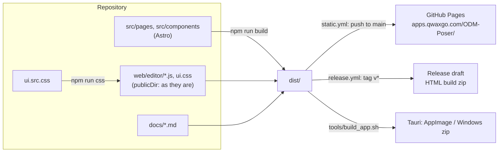
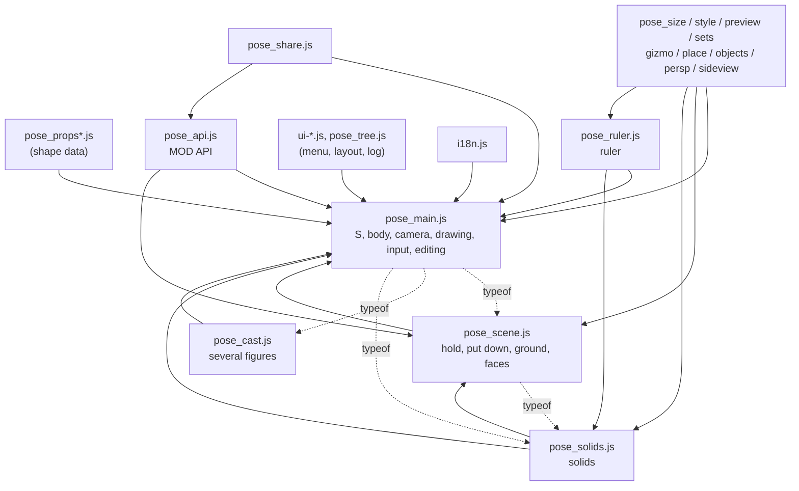
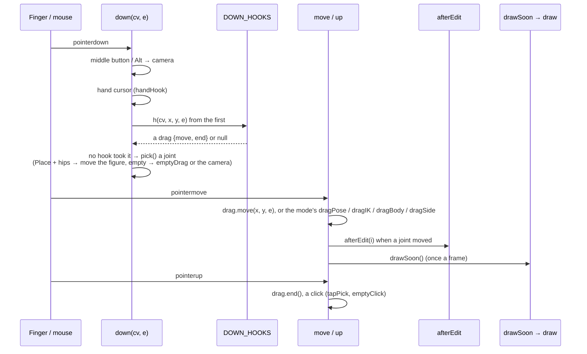
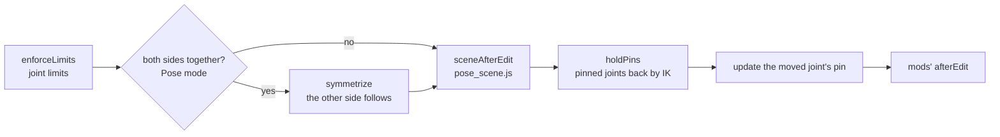
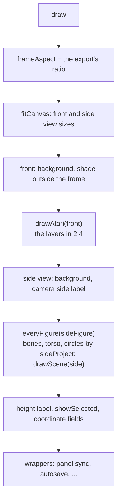
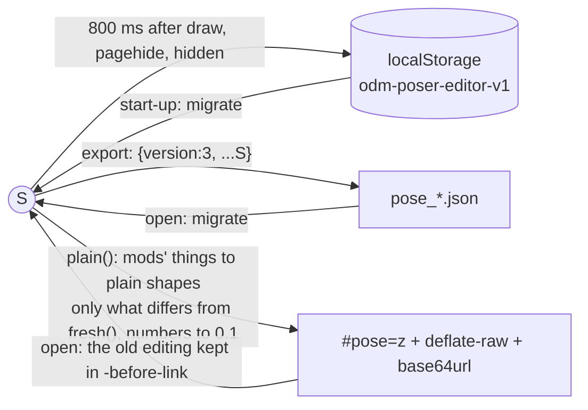

# Design: how the ODM Poser (立体人形装置) editor is built

日本語: [ARCHITECTURE-JA.md](ARCHITECTURE-JA.md)

## 0. About this document

- **Purpose**: before refactoring, set down the features as they are and how they are built, so a person can read and understand them. No feature changes. This document says how things are now; the last chapter (10) lists what a refactoring must keep and where the hard parts are.
- **Reader**: a developer who knows JavaScript but is new to this code.
- **As of**: v0.2.0 in development (2026-11-11). Code is pointed at by function and variable names, not line numbers (those move quickly).
- **What other documents cover**:
  - [HANDOFF.md](HANDOFF.md): the hand-over notes (the owner's rules, open items).
  - [MODDING.md](MODDING.md): the MOD API, for mod authors.
  - [MANUAL.md](MANUAL.md) and the others: how to use the editor.
  - [AGENTS.md](../AGENTS.md): how the UI is built and checked (melta UI).
- This document is not among the site's docs pages (`src/content.config.ts` picks the published files by name).

### Terms

| Term | Meaning |
|------|---------|
| Rough (アタリ) | The figure drawn in lines and circles: what the editor draws |
| Figure | A mannequin of 21 joints; there can be several |
| Item / thing | Something held, worn or put down on its own: `S.items` |
| Solid / object | Boxes, prisms, cylinders, walls, floor slabs, ceilings: `S.solids` |
| Env | The ground's height and the grounding setting: `S.env` |
| Front view | Seen by the camera: canvas `#front` |
| Side view | An orthographic view from the side: canvas `#side` |
| Mode | Pose, Body, Camera, Place; inside: `pose` / `body` / `persp` / `place` (Camera is `persp`) |
| Tab (menu) | One page of the panel on the right: `section[data-menu="…"]` |

## 1. The whole picture

### 1.1 What it does

A pseudo-3D pose editor in the browser. It keeps the figure's joints as 3D coordinates and draws them as lines and circles on a Canvas 2D. With things, objects, a floor and a ruler you build a composition, then export:

- the rough picture
- an OpenPose picture (COCO 18 points and 21 for each hand)
- the composition picture
- the pose file (JSON)
- a share link carrying the editing data

There is no WebGL: all drawing is its own projection and Canvas 2D lines.

### 1.2 Where it runs, and the limits that come from that

| Where | What | Limits |
|-------|------|--------|
| The site (GitHub Pages) | A static Astro site, `/ODM-Poser/editor/` | No server-side processing |
| The app (PWA) | The same page kept by `sw.js`, opening offline too | — |
| The HTML build (a Releases zip) | Opened from disk (`file://`) | **No ES modules, no fetch of its own files**: everything is a classic script |
| The executable (Tauri) | `src-tauri/`; saving through the app's `save_file` command | `window.ODM_APP_SAVE` replaces the saving |
| The ComfyUI bridge (another repository) | Carries the HTML build | Relies on `../mods.js`, `../mods/`, the MOD API and the state format |

There are also rules for how the code is written:

- No `?.` and no `??`: esprima, used for the syntax check, cannot read them.
- Exported files are CC0, the tool MIT. Nothing with someone else's rights goes in (HANDOFF.md).

### 1.3 The repository

| Where | What |
|-------|------|
| `src/pages/editor/index.astro` | The editor's page; it also sets the order the scripts load in |
| `src/components/editor/*.astro` | The editor's HTML (Stage = the views, Panel* = parts of the panel); plain HTML without props |
| `web/editor/*.js` | The editor itself (about 11,300 lines in 29 files), served as it is as Astro's `publicDir` |
| `web/editor/ui.src.css` → `ui.css` | The look, made by Tailwind CSS 4 (`npm run css`); never edit `ui.css` by hand |
| `web/editor/sw.js`, `manifest.webmanifest` | The PWA |
| `src/pages/docs/`, `src/lib/docs.ts`, `docs/*.md` | The docs pages for users |
| `src-tauri/` | The app (Rust); it serves the mods folder through `odmmods://` |
| `tools/` | Build and check tools (`lint_ui.py`, `dist_server.py`, `make_release_html.py`, ...) |
| `design/melta-ui/` (a submodule), `design-system/` | The melta UI design system and this project's overrides |
| `mods/` | The user's mods (only the README is tracked) |

### 1.4 Build and delivery



- `index.astro` puts a mark that changes with every build (`?v=…`) after each script, so an old cached copy is not used.
- The page is written in Japanese; `i18n.js` turns it into English as it is shown (6.4).

## 2. At run time

### 2.1 Classic scripts sharing one global scope

The editor's scripts are loaded with `<script is:inline>` in `index.astro`'s order. There is no module system: **every file shares one global namespace**.

- `pose_main.js` is not wrapped in an IIFE. Its about 280 top-level names (`S`, `J`, `IX`, `draw`, `project`, ...) are globals as they are.
- `pose_scene.js`, `pose_cast.js`, `pose_solids.js`, `pose_style.js` and `pose_ruler.js` also put functions at the top level.
- The files after them are mostly wrapped in IIFEs and hand out only `window.ODM…` objects.

| # | File | Lines | Job | Hands out |
|--:|------|------:|-----|-----------|
| 1 | `ui.js` | 119 | Gives each control melta UI's classes (MutationObserver) | `ODMUI` (part) |
| 2 | `pose_props.js` | 457 | The things' shapes (hand-made primitives) | `PROP_CATS`, `PROPS` |
| 3 | `pose_props_more.js` | 271 | More things (effects, worn things, simple solids) | (adds to `PROPS`) |
| 4 | `pose_main.js` | 2382 | The core: the body, the state `S`, the camera and projection, drawing, input, the edit pipeline, the basic panel, files | about 280 globals |
| 5 | `pose_scene.js` | 1291 | The floor and grounding; holding, wearing, putting down; riding, grabbing, the wire; standing on faces | `drawScene`, `sceneAfterEdit`, `partSets`, ... |
| 6 | `pose_cast.js` | 185 | More than one figure (swapped in to be drawn) | `everyFigure`, `withFigure`, `onlyFigure` |
| 7 | `pose_sets.js` | 135 | Saved poses and bodies (in the browser) | — |
| 8 | `pose_solids.js` | 386 | Solids (mesh, drawing, grounding, putting on faces) | `solidMesh`, `groundSolid`, `SOLID_KINDS`, ... |
| 9 | `pose_size.js` | 302 | Sizes (part lengths, the head's shape, a thing's three axes) | — |
| 10 | `pose_style.js` | 441 | Line colours and auras | drawing through `partColor`, `AURA_KINDS` |
| 11 | `pose_preview.js` | 201 | The preview before putting | — |
| 12 | `pose_ruler.js` | 444 | The perspective ruler and guide shapes, snapping | `drawRuler`, `vanish`, `snapSolid`, ... |
| 13 | `pose_gizmo.js` | 455 | The 3-axis handles | `ODMGizmo`, `ODMGizmoTargets` |
| 14 | `pose_place.js` | 538 | The Objects tab (the list to put, place / turn / size of what is out, putting on a face) | `ODMGhost`, `ODMPlaceGuide` |
| 15 | `pose_objects.js` | 448 | Solids and things as one selection (several, cut / paste, cursors, pivots) | `ODMObj` |
| 16 | `pose_persp.js` | 302 | Exaggerated perspective (the pivot, the camera moved for a while) | `ODMPxMark` |
| 17 | `pose_sideview.js` | 157 | The side view's camera | — |
| 18 | `i18n.js` | 689 | Japanese → English | `ODMPoserI18n` |
| 19 | `ui-icons.js` | 62 | The menu's icons (SVG) | `ODMICONS` |
| 20 | `ui-menu.js` | 201 | The panel's menu (three levels) and tabs | `ODMUI.showMenu`, ... |
| 21 | `ui-figure.js` | 159 | The body map (what is being edited) | — |
| 22 | `pose_tree.js` | 110 | The Scene list tab | — |
| 23 | `ui-help.js` | 171 | The controls' hints | — |
| 24 | `ui-log.js` | 107 | The work log | — |
| 25 | `../mods.js` | — | The list of mods (outside the page; the host serves it) | `ODM_POSER_MODS` |
| 26 | `pose_api.js` | 581 | The MOD API and the mod loader | `ODMPoser` (old name `SymbolicPose`) |
| 27 | `pose_share.js` | 313 | Posting to social media and `#pose=` links | — |
| 28 | `ui-layout.js` | 130 | The panel's arrangement (labels paired with their fields) | — |
| 29 | `ui-pane.js` | 135 | The edge between the views and the panel, the modes' columns | — |
| 30 | `ui-sheet.js` | 117 | The upright phone / tablet layout (bottom bar and sheets) | — |

Files after `i18n.js` (`ui-*.js`, `pose_api.js`, ...) can count on it. Earlier files push their tables onto `window.ODMPoserI18nEarly`, and `i18n.js` takes them when it loads.

### 2.2 Which way the dependencies go

Arrows mean "uses". Almost every file uses `pose_main.js`'s names directly.



Dotted arrows are calls made only when `typeof X === "function"`: `pose_main.js` calls `drawScene`, `sceneAfterEdit`, `everyFigure`, `solidMesh`, `pixelRay` and others, defined later, this way.

### 2.3 Four ways a file adds to another

Files add to earlier ones in four ways. For a refactoring, know the first above all.

1. **Wrapping (overwriting a function)**: the earlier function is kept in a variable and replaced.
   ```js
   { const atari0 = drawAtari;
     drawAtari = function(ctx, W, H, opts = {}){ atari0(ctx, W, H, opts); /* its own drawing */ }; }
   ```
   A function declaration can be reassigned, so every later call goes to the new function. **The order of the calls is the order the files load in.**
2. **Hook arrays**: `DOWN_HOOKS` (a press) and `WHEEL_HOOKS` (the wheel). `down()` in `pose_main.js` calls them from the first, and the first to return a drag (`{move, end}`) takes the input. One added with `unshift` comes first (table in 2.4).
3. **Calling if present with `typeof`** (dotted in 2.2).
4. **`window.ODM…` objects**: `ODMObj` (selection), `ODMGizmo` and `ODMGizmoTargets` (a place to add targets for the 3-axis handles), `ODMUI` (the menu), `ODMPxMark` (the pivot's mark), `ODMGhost` (the thing about to be put), `ODMPoser` (the MOD API).

There are slots too: `handHook`, `emptyDrag`, `emptyClick`, `tapClick` and `gizmoHolds` in `pose_main.js` start empty, and `pose_objects.js` and `pose_gizmo.js` fill them.

### 2.4 The wrapping chains

**`drawAtari(ctx, W, H, opts)`** draws the figures and what is round them into one picture (the front view, an export, the phone's small view). These 11 files wrap it, one over the other. A call goes in from the outside (the file loaded last):

| From outside | File | Before calling in | After calling in |
|---:|------|-------------------|------------------|
| 1 | `pose_api.js` | The mods' `drawBehind` | The mods' `draw` |
| 2 | `pose_persp.js` | — | The pivot's mark (front view, not exports) |
| 3 | `pose_objects.js` | — | Pivot and group marks (Place mode) |
| 4 | `pose_place.js` | — | The thing about to be put (Objects tab) |
| 5 | `pose_gizmo.js` | — | The 3-axis handles |
| 6 | `pose_ruler.js` | The ruler (not exports) | — |
| 7 | `pose_preview.js` | — | The Equip / Objects preview |
| 8 | `pose_style.js` | Everyone's auras (flame and glow behind) | Plasma (in front) |
| 9 | `pose_solids.js` | Solids | — |
| 10 | `pose_cast.js` | — | Calls in once per figure (farthest first; from the second on, without the surroundings) |
| 11 | `pose_main.js` (the original) | `drawFigure` inside `withPX(figPX(), …)` (the exaggerated camera) | — |

`drawFigure` calls `drawScene` (floor, things, wire; also wrapped by `pose_solids.js` and `pose_api.js`). **What is drawn on top of what comes from the load order and the way each file wraps.**

**`draw()`** draws the whole screen again (its body is the flow in 4.4). 17 wrappers in 12 files each bring their own panel in step:

| File | What its wrapper does |
|------|------------------------|
| `pose_main.js` (last) | `saveLocal()` 800 ms later (autosave to the browser) |
| `pose_size.js` (2) | The head shape's fields, the size numbers |
| `pose_style.js` | The colour panel's list of things |
| `pose_place.js` | The Objects panel (while the tab is open) |
| `pose_objects.js` (3) | The selection box, the cursor, the edit buttons' enabled state |
| `pose_persp.js` (2) | The pivot's mark on the side view, the Perspective panel |
| `pose_sideview.js` | The Side view panel |
| `ui-figure.js` | The body map |
| `pose_tree.js` | The Scene list |
| `ui-layout.js` (2) | The layout pictures, number / slider pairs |
| `ui-pane.js` | The edge, the columns |
| `ui-sheet.js` | The phone sheet's small view |

So **`draw()` is drawing + panel sync + autosave** at once.

**`syncUI()`** brings the panels in step with `S` after `S` was replaced as a whole (undo, opening a file, a link, the work log). Wrapped by `pose_main.js` (saved cameras), `pose_scene.js`, `pose_cast.js`, `pose_solids.js`, `pose_style.js`, `pose_ruler.js`, `pose_tree.js` and `pose_api.js` (the mods' `sync`).

**Other wrapped functions**

| Function | Wrapped in | Why |
|----------|-----------|-----|
| `afterEdit` | `pose_api.js` | The mods' `afterEdit` |
| `drawOpenpose`, `applyPreset` | `pose_cast.js` | Each figure / keep where it stands |
| `camHeld`, `camLockUI`, `exportCanvas`, `upgradeState` | `pose_persp.js` | The camera moved for a while (moving while locked; exports with the locked camera) |
| `emptyClick`, `tapClick` | `pose_objects.js` → `pose_persp.js` | A click on an empty place; letting go of the pivot |
| `down` | `pose_sideview.js` | Turning / moving the side view, dragging the pivot there |
| `remember`, `say`, `toast` | `ui-log.js` | Writing the work log |
| `addItem`, `addSolid` | `pose_preview.js` | Putting at the size set before |

**What is in `DOWN_HOOKS`**: hooks from `pose_main.js` (automatic mode switching), `pose_scene.js`, `pose_solids.js`, `pose_ruler.js`, `pose_gizmo.js`, `pose_objects.js`, `pose_cast.js` and `pose_persp.js`. Others come and go (clicking a face to stand on, putting on a face), and the mods' `pointerDown` goes in before the last one.

## 3. State (the data model)

### 3.1 `S`: everything being edited

`let S = fresh();` (`pose_main.js`) is the unit of saving, undo and sharing. **`S` is replaced as a whole** (undo, opening a file, a share link, the work log, a mod's `loadPose`). Other files must not keep `S` or anything in it in a variable; read from `S.…` each time (keeping an old object and writing to it was a real bug).

| Field | What | Mostly in |
|-------|------|-----------|
| `P` | 21 joints' 3D coordinates (cm, y up, the figure faces +z), in `J`'s order | almost all |
| `R` | Joint circles' radii (cm) | main, size, scene |
| `twist` | Each joint's twist (degrees) | main, gizmo |
| `hands` | `{r, l}` hand shape names (`HANDS`) | main, scene |
| `head`, `headShape` | The head (old), the head's shape (stretch) | main, size |
| `body` | The whole body's turn `{yaw, pitch, roll}` | main |
| `pins` | `{joint index: [x, y, z]}` pinned joints | main, scene |
| `shape`, `scale`, `sex`, `torso3d` | Shoulders' / thigh roots' rest directions, the old scale, sex, whether the torso is solid | main, sets |
| `items` | Things (5.6) | scene and many |
| `solids` | Solids (5.7); walls and ceilings are solids | solids and many |
| `env` | `{floor, floorY, ground, attach, show, …}` floor and grounding; `wall` / `ceiling` are the old form (`migrateEnv` turns them into solids) | scene |
| `wire` | Wire action `{on, joint, anchor, length}` | scene |
| `stand` | The face the figure stands on `{p, n}` (wall, ceiling, slope) | scene |
| `auras`, `colors` | Auras, line colours | style |
| `cam`, `center` | Camera `{lens, yaw, pitch, roll, zoom}` and the point it looks at | main |
| `cams`, `camLock`, `camPeek` | Saved cameras, the lock, the camera moved for a while | main, persp |
| `persp` | Exaggerated perspective `{pivot, k, mark}` | persp |
| `sideView` | The side view's camera `{from, key, joint, yaw, pitch, zoom, pan}` | sideview |
| `ruler` | The perspective ruler | ruler |
| `others`, `figId`, `figName` | The other figures (with the `FIG_KEYS` fields), the edited figure's number and name | cast |
| `mods` | `{mod id: that mod's data}` | api |

### 3.2 The body

- `J`: the 21 joint names, `pelvis, waist, chest, neck, head, r_shoulder, r_elbow, r_wrist, l_shoulder, l_elbow, l_wrist, r_hip, r_knee, r_ankle, r_toe, l_hip, l_knee, l_ankle, l_toe, r_hand, l_hand`. The hands come last so an older 19-joint file reads by appending (`upgradeState`).
- `IX[name]` is the index, `PARENT[i]` the parent, `KIDS[i]` the children, `MIRROR[i]` the other side.
- `REST` and `REST_R` are the standing coordinates and radii; `SEX_BODY` the bone lengths and widths for each sex.
- Bone lengths are worked out from the coordinates each time (not kept apart).

### 3.3 State outside `S`

| State | Where | Meaning |
|-------|-------|---------|
| `sel` | pose_main.js | The selected joint's index (-1: none) |
| `mode` | pose_main.js | The mode (`pose` / `body` / `persp` / `place`) |
| `scSel` | pose_scene.js | The selected thing's index in `S.items` |
| `soSel` | pose_solids.js | The selected solid's index in `S.solids` |
| Selection (a set of keys `"s3"` / `"i2"`) | pose_objects.js (`ODMObj`) | Place mode's selection (several possible) |
| `sel` (Objects tab) | pose_place.js (inside its IIFE) | The key chosen in the Objects tab |
| `drag` | pose_main.js | The drag going on |
| `PX`, `frameAspect`, `occFrozen`, `occMemo` | pose_main.js | Values used during drawing, and memos |
| Export settings | DOM fields (`#W`, `#H`, `#ratio`, `#atariMode`, `#cm*`, ...) | `exportSize()` and others read the fields directly |
| View settings | DOM and localStorage (chapter 8) | Joint limits, both sides together, the cursor, ... |

The selection being split over several places, and pointing by index, are hard parts in chapter 10.

### 3.4 Saved form and compatibility

- A file is `{version: 3, ...S}` (`saveJson`). Reading runs `migrate(d)` to fix older forms, then `Object.assign(fresh(), d)` fills missing fields with defaults:
  - 18 joints (v1, no waist)
  - `head.yaw` (v2) → the head's twist
  - 19 joints (no hands) → `upgradeState`
- `syncUI()` also calls `upgradeState(S)` first.
- A thing's older sizes (`len`, `thick`) are read by `stretchOf`, and `foldStretch` turns them into `stretch` when edited.
- A share link carries only the fields that differ from `fresh()` (4.6).

## 4. The main flows

### 4.1 Start-up

1. `pose_main.js` loads:
   - `S = fresh()`
   - wires up input and panel events
   - restores the export size and composition settings from `localStorage`
   - restores `S` from `localStorage`'s `odm-poser-editor-v1` (`migrate`)
   - `syncUI(); draw();`
2. The later files in turn wrap, add hooks and build panels (`innerHTML`); many call `draw()` there and then.
3. `i18n.js` decides the language and translates the whole page; elements added later are translated through a MutationObserver.
4. `ui-menu.js` splits the panel's `section`s at their headings and moves them under tabs (moved, not rebuilt).
5. `pose_api.js` loads the mods in `window.ODM_POSER_MODS` (`?nomods`: none).
6. `pose_share.js` opens a `#pose=` in the address.
7. `ui-layout.js`, `ui-pane.js` and `ui-sheet.js` arrange the layout.

### 4.2 Input: press → hooks → drag

Mouse, touch and pen all come through Pointer Events and are made alike by `evMods()`. The on-screen "Shift" / "Pin" toggles (`VMOD`), a pen's buttons and the right button count as Shift / Alt.



- Two fingers (pinch and move) are handled apart by `pinch` in `pose_main.js`; on the side view by `pose_sideview.js`.
- On touch, a joint is tapped first to be dragged (so it is not moved by mistake).
- While the 3-axis handles show (`gizmoHolds()`), a direct drag on a joint or thing only selects.
- `remember()` is called before an edit to keep the undo step; when a hook returns a drag, `down()` calls it.

### 4.3 The edit pipeline (afterEdit)

An edit that moves joints ends in `afterEdit(moved)`:



Inside `sceneAfterEdit(moved)`, in order:

1. `followItems`: held things follow the hands.
2. The wire: past its length, the whole body is pulled back.
3. In Place mode, hips brought near a face make the figure stand on it (`attachNear`).
4. Standing on a face: kept on it (`onPlane`).
5. Otherwise grounding (`groundLift`: onto the floor or solid tops, not into them / always touching).

### 4.4 Drawing (draw)



- Exports use the same `drawAtari`; `opts.export` leaves out what belongs on screen only (ruler, handles, marks, previews).
- Canvas colours are read from CSS variables (`cssVar("--figure")` and the like), so the dark theme follows.
- For dashed hidden lines (5.4), `occFrozen` gathers everyone's occluders first.

### 4.5 Undo and the work log

- `remember()` pushes `JSON.stringify(S)` onto `history` (up to 80; not when equal to the last). `undo` / `redo` parse the text back into `S`, then `syncUI(); draw();`.
- Sliders call `remember()` on `pointerdown` and on keys: one drag is one step.
- `ui-log.js` wraps `remember` / `say` / `toast` and keeps, for each operation, the time, the message and a copy of `S` (up to 100, in the browser); any point can be brought back.

### 4.6 Saving, opening, autosave, share links



- A share link holds `{v: 1, s: diff, mods: [official mod URLs]}`. Only official mods (qwaxgo's on GitHub) travel; other mods' things and solids become plain shapes (`plain`).
- What follows `#` never reaches a server, so the social card cannot show each composition. A post carries the picture itself instead: a phone hands it to the share menu, a computer copies it to the clipboard (`shareImage`).

### 4.7 Exporting

- `exportSize()` reads the `#W` / `#H` fields. `exportCanvas()` makes a canvas, smaller if the device cannot draw that big (iOS's limit, ...).
- The rough picture is `render("atari")`; with `#atariMode` on Composition it draws solids and the surroundings too. The OpenPose picture is `render("openpose")`, the composition picture `compCanvas()` / `renderComposition()`.
- Saving is `download(url, name)`: a PNG is shown for a check before it is saved; the app uses `window.ODM_APP_SAVE`.
- The camera's frame has the export's ratio (`frameWH`); the front view is wider than the frame and shades what lies outside it.

## 5. The main mechanisms in detail

### 5.1 Coordinates, camera, projection

- World coordinates are in cm, y up. The figure first faces +z (toward the camera); its right is screen left (x < 0).
- The camera turns round the point it looks at, `S.center`. `camRot(v)` turns world into camera space (yaw → pitch → roll); `camRotInv` is the reverse.
- The frame `frameWH(W, H)` is the largest rectangle of the export's ratio inside a `W×H` canvas.
- The lens's focal length (pixels) and the camera's distance (cm):

  ```
  f = lens / 36 × h            (h: the frame's height; the lens is taken on the picture's height)
  D = lens / 36 × 190 / 0.86 / zoom   (the distance at which 190 cm fills 86 % of the height)
  ```

  `D` does not depend on the picture's ratio: changing the ratio does not move the camera.
- Projection `project(p, W, H)`:

  ```
  q = camRot(p − center)
  d = max(D − q.z, 1)
  x = cx + f·q.x / d,  y = cy − f·q.y / d,  s = f / d (pixels per cm)
  ```

  `cx`, `cy` are the canvas's middle, except under exaggeration (5.2).
- The other way: `pixDir(x, y, W, H)` gives a pixel's direction in camera space, `pixelRay` (pose_solids.js) a ray in the world. Drags, clicked faces and handles use them.

### 5.2 Exaggerated perspective (PX)

While the camera is locked, perspective is pushed further about one pivot. Everything is drawn by one camera, so lines stay straight and things that touch still touch.

- `pxNow()` returns a value only when `S.camLock && !S.camPeek && S.persp.k`:
  ```
  k  = exK(strength %) = 1 − 0.04^(strength/100)
  q  = toCam(pivot)
  PX = {k, qz: q.z, cw: camRotInv([k·q.x, k·q.y, 0]), o: [k·q.x/d, k·q.y/d]}   (d = D − q.z)
  ```
- With `PX` set, drawing does this:
  - the camera moves k of the way toward the pivot: `camDist = D − k(D − qz)`
  - the lens widens as much: `f × (1 − k)`
  - the centre shifts (`o` in `cxOf` / `cyOf`) so the pivot stays at the same place on screen
  - `withPX(px, fn)` sets `PX` while `fn` runs and moves `S.center` by `cw`
- At the pivot's depth sizes stay; behind it things shrink toward it, in front they grow. A vanishing point moves to `VP' = sp + (1 − k)(v − sp)`, so the ruler (`vanish`, `horizonLine`) moves the same.
- The camera moved for a while (`S.camPeek = {cam, center, sid}`) keeps the locked camera in mind while the camera moves. Exports are drawn with the locked camera (wrapping `exportCanvas`). It ends on a reload or when a file is opened (a different `sid`).

### 5.3 The side view

An orthographic view. `sideBasis(W, H)` returns the screen's right `ex`, up `ey`, toward the viewer `ez`, the centre `c`, and pixels per cm `k = 0.86·H/190·zoom`.

- The direction is 90° from the camera's yaw (from the right or the left), plus `S.sideView.yaw` and `pitch`.
- The centre is `sideCentre` (the look-at point, a figure's joint, an object) plus `pan`.
- `sideProject` projects; `sideUnproject(x, y, W, H, p)` turns a pixel back into the world at point `p`'s depth (for drags).

### 5.4 Hidden lines (dashed)

With `S.hiddenDashed`, lines behind a body or a solid, seen from the camera, are dashed.

- `occluders(W, H)` gathers what hides: every figure's joint spheres (`bodySpheres`) and the solids' meshes. It is memoised by a key made from the camera, the poses and the solids (`occMemo`).
- `hiddenAt(q)` checks whether the segment from the eye to the point hits anything. `strokeSeen` draws a segment piece by piece, solid where seen, dashed where hidden.
- The side view also judges hiddenness with **the front camera**.

### 5.5 Moving joints: IK, limits, pins

- `rotateSubtree(i, target)` turns joint i's bone toward target, and the joints beyond it with it.
- `solveIK(i, target)` is two-bone IK (shoulder → elbow → wrist, hip → knee → ankle), used when a wrist / ankle is dragged in Pose mode and when pinned joints are held.
- `enforceLimits()` limits angles by human joint limits (`BALL`, `HINGE`, `FOOT`, `TWIST`), switched by the joint limits setting.
- Joints in `S.pins` are put back by `holdPins` after every edit.
- Body changes are wrapped in `fromBottom(fn)` to keep the lowest point. Shoulders and thigh roots change width, height and depth along the torso's axes (`torsoAxes`).

### 5.6 A thing's frames

- A thing's shape is a list of primitives: `c` cylinder, `b` box, `s` sphere, `d` disc, `k` cone, `t` ring, `h` dome, `l` polyline (detailed at the top of `pose_props.js`).
- `place` is one of five:
  - `hand`: held
  - `body`: in front of the chest
  - `world`: on the floor
  - `grab`: something to hold on to
  - `wear`: worn
- `partSets(it)` returns where the thing is drawn, `[{f: frame, parts}]` (a pair of shoes gives two). The frame `f = {o, x, y, z, k}` comes from the place: `gripFrame` in the hand, `chestFrame`, `worldFrame` (`base` and `yaw`) on the floor, `wearFrame` worn.
- `itemLocal(it, p)` applies to a point in the thing's own coordinates, in order:
  1. the grip point as the origin (when held)
  2. `scale` and `stretch`
  3. `rot` (z → x → y)
  4. `off`

  Then `itemToWorld` puts it in frame `f`.
- Section lengths (`def.segs` and `it.segs`): `segParts` stretches the axis piece by piece.

### 5.7 Solids: mesh, grounding, putting on a face

- `solidMesh(o)` returns `{V: vertices, faces: [{v, n, d}], edges}`.
  - `o.pos` is the base's middle, `o.size = [width, height, depth]`.
  - The turn is `roll` (z) → `pitch` (x) → `yaw` (up), about the base's middle.
  - Prisms and pyramids use `sides` and `top`; cylinders and cones are 32-gons.
- `supportUnder(p, bottom)` (pose_scene.js) returns the highest of the floor and the solids' tops (`solidTopsAt`) that is at most 40 cm (`STEP_UP`) above the lowest point. `groundSolid` and `groundItem` move the lowest point onto it.
- **Putting on a face** (pose_place.js): after **Put on the ground** is pressed, the clicked face comes from `faceAt`. The thing is put on it in these steps:
  1. Pick the thing's face whose outward normal is nearest the face's normal turned round (`nf`); a thing uses the 6 sides of the box on its own axes.
  2. Turn it by the least rotation taking `nf` onto that reversed normal (axis `nf × want`).
  3. Turn the new orientation back into yaw, pitch and roll (`turnOf`).
  4. Keep its middle and move it only along the face's normal until it touches.
- Standing on and putting joints on solids use `closestOnSolid`, `rayHit` and `solidTopsAt`.

### 5.8 Standing a figure on a face (S.stand)

With `S.stand = {p, n}` the figure takes that face as "down": sideways on a wall, upside down on a ceiling.

- `standOnFace` turns the body to the face's normal.
- `onPlane` keeps the lowest point on the face after every edit.
- In Place mode, hips brought near a face (within 15 cm) make `attachNear` stand the figure on it.
- Upright over the floor, `S.stand` is dropped and ordinary grounding takes over.

### 5.9 The 3-axis handles

`pose_gizmo.js` decides each mode's tools (move, rotate, scale) and targets:

| Mode | Targets | Tools |
|------|---------|-------|
| Pose | Joints | Rotate; move for arms / legs and shoulders / thigh roots |
| Body | Joints, the head | Scale |
| Place | Solids, things, the ruler's box, the figure (by its hips) | Move, rotate, scale |

- Move arrows keep to the world's X, Y, Z; rotate and scale to the thing's own axes.
- Other files add their own targets through `window.ODMGizmoTargets` (the perspective pivot does).

### 5.10 How selection works

| What | State | Picked from |
|------|-------|-------------|
| A joint | `sel` (index) | Click, the body map, the panel |
| A thing (Equip tab) | `scSel` (index in `S.items`) | The Equip list |
| A solid (old panel) | `soSel` (index in `S.solids`) | The solid list |
| Place selection | `ODMObj` (a set of `"sN"` / `"iN"`) | Click, a box, Ctrl + click |
| Objects tab | `sel` in `pose_place.js` (a key) | The list of what is out |
| The perspective pivot | `pxSel` in `pose_persp.js` | Clicking the mark |

The same thing is pointed at in different forms by different files; when things are deleted or reordered, each file keeps its index right itself.

### 5.11 Several figures

- The edited figure is `S`'s own fields; the others wait in `S.others` with the same fields (`FIG_KEYS`).
- To draw one, `withFigure(f, fn)` swaps `S`'s fields for that figure's, calls `fn`, and swaps back.
- `everyFigure(fn)` draws from the farthest figure; `onlyFigure(id, fn)` draws one (the export's figure choice).
- So every tool only needs to know the edited figure. On the other hand, **reading `S` in the middle of drawing may give another figure's values.**
- Things put down are gathered on the edited figure's side (`gatherLoose`).

## 6. UI

### 6.1 Markup and look

- The HTML is in `src/components/editor/*.astro`: plain HTML without props.
- `ui.js` gives elements melta UI's classes by kind: `section` → card, `button` → outlined, `.primary` → contained. Panels added later get the same through a MutationObserver. So **markup carries no colours or spacing**. Only `data-ui="skip"` elements keep their own look.
- `ui.src.css` holds melta's tokens, the light and dark values and the app shell (split screen, the views, the camera pad); `npm run css` makes `ui.css`.
- Check with `python tools/lint_ui.py` (melta-lint; 0 errors required).

### 6.2 The menu (three levels)

`TREE` in `ui-menu.js` is the menu's tree:

- **Make**: Figure (Pose, Presets, Body, Colors, Reset), Things & places (Equip, Objects, Place)
- **View**: Scenes (Scene, Work log), Viewpoint (Camera, Ruler, Perspective, Side view)
- **Output**: File (Import, Export, Share, MOD)

A tab's content is `aside > section[data-menu="tab id"]`. Panels other files build are split at each heading (h2) and put under a tab by what they hold. Modes and tabs go together (`MENU_OF`: Pose → pose, Body → body, Camera → camera, Place → objects).

### 6.3 Layout for each device

| File | Job |
|------|-----|
| `ui-layout.js` | Where the panel goes (right, left, top, bottom, put away), where the side view goes, label / field pairs |
| `ui-pane.js` | The grip on the edge between the views and the panel (`--aside-w`, `--split-k`), the modes' two columns |
| `ui-sheet.js` | The upright phone (full-screen views, bottom bar, translucent sheets) and the upright tablet (`sheet-tall`) |

CSS switches layouts by `body`'s classes (`sheet`, `split`, `touch`, `mode-*`, ...).

### 6.4 Japanese and English (i18n.js)

- The page is written in Japanese; in English `i18n.js` replaces what is shown:
  - text nodes, placeholders and titles through the table `T`
  - messages built at run time through rules `RULES` (regular expressions)
  - canvas text by patching `CanvasRenderingContext2D.fillText`
- **The Japanese string itself is the translation key.** When Japanese UI text changes, change its English in `i18n.js` (or in that file's `ODMPoserI18n.add`) as well.

## 7. The MOD API and promises to the outside

- A mod is a script that calls `ODMPoser.registerMod({id, name, version, api: 1, init(api){…}})`. Through `api` it adds:
  - things and their categories, solid kinds, auras, hand shapes, poses, user presets
  - translations, menus and panels
  - hooks (`api.on`)
- `api.on`'s events are `drawBehind`, `draw`, `drawSide`, `afterEdit`, `sync`, `mode`, `pointerDown` and `wheel`. A mod's errors are caught by `guarded`, shown in the MOD panel, and the editor goes on.
- The API's version is `1.2.0` (`API_VERSION`, major 1). See [MODDING.md](MODDING.md).
- A host (the ComfyUI bridge, ...) talks to the editor only through the MOD API and `../mods.js`.

## 8. What the browser keeps (localStorage)

`KEY = "odm-poser-editor-v1"`. Changing a key hides users' data.

| Key | What | Where |
|-----|------|-------|
| `KEY` | The `S` being edited | pose_main.js |
| `KEY-view` | The mode and the open tab | pose_main.js |
| `KEY-picture` (`odm-poser-editor-v1-picture`) | The export's ratio and size, the rough picture's content, the composition settings | pose_main.js |
| `KEY-limits`, `-sympose`, `-thicklink`, `-automode`, `-pad`, `-split` | View and control settings | pose_main.js |
| `KEY-posesets`, `-bodysets` | Saved poses and bodies | pose_sets.js |
| `KEY-colorsets` | Colour sets | pose_style.js |
| `KEY-objpresets` | Object presets | pose_place.js |
| `KEY-clip`, `-cursor` | The copied things, the cursor | pose_objects.js |
| `KEY-gizmo`, `-gizmotool` | The 3-axis handles shown and their tool | pose_gizmo.js |
| `KEY-log` | The work log | ui-log.js |
| `KEY-barpos` | The phone bar's position | ui-sheet.js |
| `KEY-before-link`, `-share-hosts` | The editing before a link was opened, the Misskey / Mastodon servers | pose_share.js |
| `odm-poser-fold-*` | Folded corner panels on the views | ui-menu.js |
| `odm-poser-theme`, `odm-poser-lang` | Theme, language | pose_main.js, i18n.js |

Besides localStorage:

- IndexedDB `odm-poser-mods`: the picked mods folder (pose_api.js).
- Cache Storage `odm-poser-editor-v3`: the files the PWA keeps (sw.js); caches under older names are deleted.
- Keys from before the name ODM Poser (`symbolic-pose-*`) are copied once to `odm-poser-*` (pose_main.js).

## 9. Tests and checks

The repository has three checks now:

- Syntax: esprima reads `web/editor/*.js` (`syntax` in `docker-compose.test.yml`).
- UI: `python tools/lint_ui.py` (melta-lint).
- Build: `npm run build`.

**There are no automated behaviour tests in the repository.** During development, behaviour was checked with Playwright (Python) through `tools/dist_server.editor()`, writing tests as needed, but those test files were not kept. Before refactoring, putting tests of the main behaviour into the repository is advised (10.3).

## 10. Notes for the refactoring

### 10.1 What must not change (promises to the outside)

| Promise | Relied on by |
|---------|--------------|
| The state format `version: 3`, and `S`'s field names and meanings | Files, share links, the ComfyUI bridge, the owner's other project, mods (`S.mods`) |
| `window.ODMPoser` (old name `window.SymbolicPose`) and API 1.x | Mods, hosts |
| `../mods.js` and the `mods/` layout, `ODM_POSER_MODS` | The HTML build, the app, the ComfyUI bridge |
| The `#pose=` link format (`j` / `z` + base64url, `{v: 1, s, mods}`) | Links already shared |
| The localStorage keys (chapter 8) | Users' saved data |
| Working from `file://` (classic scripts, no fetch of its own files) | The HTML build |
| No `?.` and no `??` | The syntax check (esprima) |
| The Japanese UI strings (= translation keys) | i18n.js |
| Tab ids (`pose`, `camera`, `export`, ...) and `#modBox` | Mods (`api.ui.addSection({menu})` places a section by tab id) |

Bundling into one classic script at build time keeps the `file://` promise; shipping ES modules as they are breaks it.

### 10.2 Hard parts and technical debt

| Problem | Where | What happens | Possible direction |
|---------|-------|--------------|--------------------|
| One global namespace | pose_main.js and others | A name clash once stopped the whole editor (`norm`) | Gather names into namespace objects; bundle into modules |
| Wrapping chains | `drawAtari` (11 layers), `draw` (17), `syncUI` (8) | Drawing and sync order follow load order; hard to see what happens where | Layer registration (`layers.add({z, draw})`), events (`on("draw")`, `on("sync")`) |
| `draw()` is drawing, panel sync and autosave | 2.4 | Every draw syncs all panels and schedules a save | Split drawing, UI updates and saving |
| Selection state split | `sel`, `scSel`, `soSel`, `ODMObj`, the Objects tab's `sel`, `pxSel` | Pointing by index drifts easily on delete or reorder | One selection mechanism with stable ids |
| `S` swapped during drawing | `withFigure`, `withPX`, `occFrozen` | Reading `S` mid-draw gives another figure's values or a moved camera; restored in `finally` on errors | Pass the figure as an argument, the camera as a value |
| `S` replaced as a whole | undo, open, links, log, mods | Kept references go stale | Keep the no-keeping rule; one state container |
| Undo is a JSON copy of all of `S` | `remember` | Heavier as scenes grow (80 steps) | Diffs, structural sharing |
| Settings live in DOM fields | Export (`#W`, `#cm*`, ...) | Logic depends on the DOM, hard to test | A settings object; fields only show it |
| Logic and UI in the same files | Many pose_*.js | `innerHTML` and messages inside calculations | Split core (calculation) and panel (UI) |
| Leftovers for old forms | `S.env.wall/ceiling`, `S.scale`, hidden old panels (`data-menu="old-place"`), `S.head.yaw` | Code that reads them remains | Fix on load and remove the rest (keep format compatibility) |
| Weak dependencies by `typeof` | pose_main.js | Which features exist is known only at run time | Make dependencies explicit (a set start-up order) |
| No automated behaviour tests | — | Changes are checked by hand or with throwaway tests | 10.3 |

### 10.3 A suggested order

To go ahead without changing features:

1. **A safety net**: put Playwright tests into the repository and run them in CI. Test:
   - start-up without errors
   - the basic operations of Pose, Body and Place
   - undo and redo
   - a file exported and opened again
   - a share link made and opened again
   - the exported pictures' sizes
   - loading a sample mod
   - the English UI

   Include reading old files (v1, v2, 19 joints).
2. **Make it visible**: first turn the wrappers in 2.4 into registration functions, with the same behaviour and the call order kept as data. Give the drawing layers explicit numbers.
3. **One selection**: build a selection that points at things by id, and make `scSel`, `soSel` and the others views of it.
4. **Split calculation from UI**: move pure calculations (projection, IK, meshes, grounding) into parts that do not touch the DOM, each with tests.
5. **Namespaces and the build**: last, move the global names into a namespace or modules, bundled into one classic script so `file://` keeps working.

At every step, pass the tests of the promises in 10.1 before going on.

## Appendix: modes and tabs

| Name on screen | Internal `mode` | Tab it opens | Main files |
|----------------|-----------------|--------------|------------|
| Pose | `pose` | Pose | pose_main.js, pose_gizmo.js |
| Body | `body` | Body | pose_main.js, pose_size.js |
| Camera | `persp` | Camera | pose_main.js |
| Place | `place` | Objects | pose_place.js, pose_objects.js, pose_scene.js |
