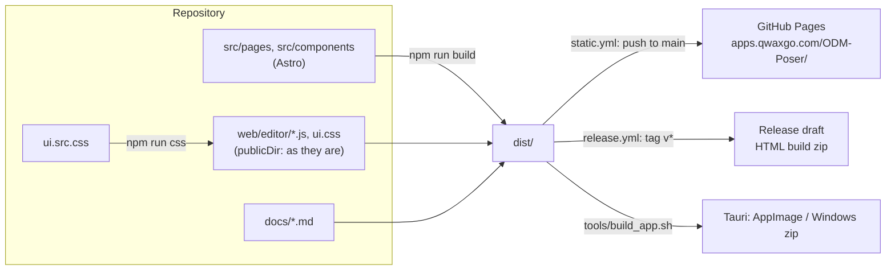
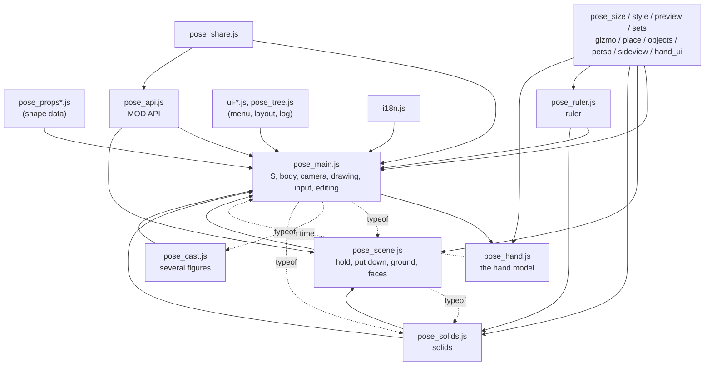
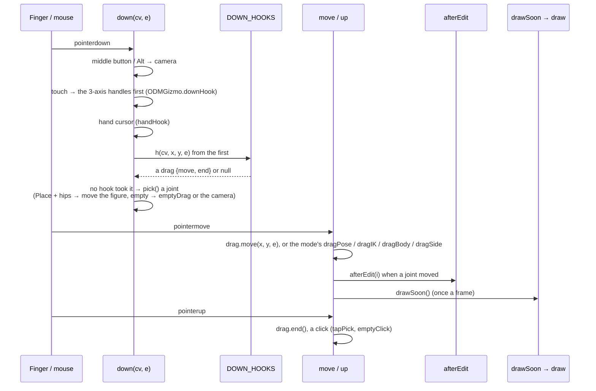
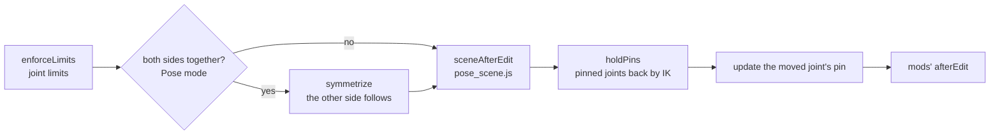
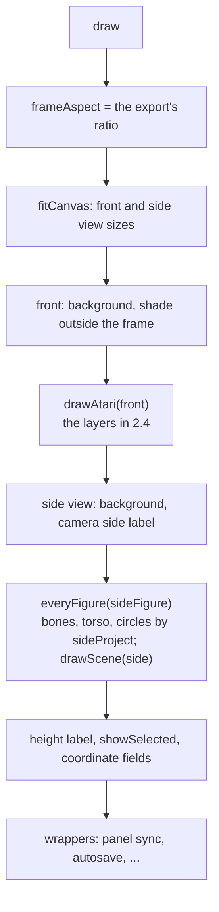
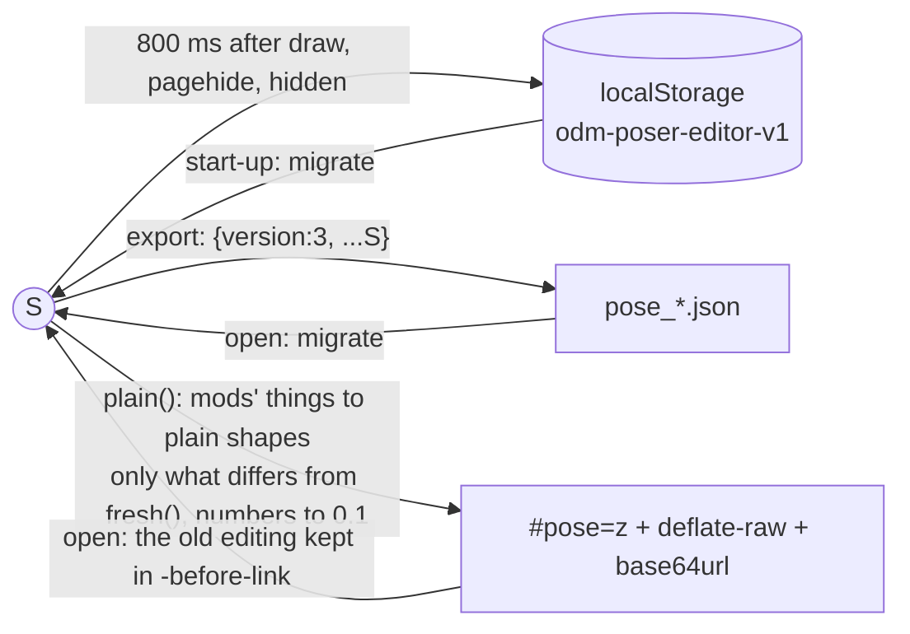

# Design: how the ODM Poser (立体人形装置) editor is built

日本語: [ARCHITECTURE-JA.md](ARCHITECTURE-JA.md)

## 0. About this document

- **Purpose**: before refactoring, set down the features as they are and how they are built, so a person can read and understand them. No feature changes. This document says how things are now; chapter 10 lists what a refactoring must keep, where the hard parts are, and a refactoring plan; chapter 11 lists every feature there is.
- **Reader**: a developer who knows JavaScript but is new to this code.
- **As of**: v0.2.0 in development (2026-11-11; the inventory of features (chapter 11) and the refactoring plan (10.4) added on 2026-11-24). Code is pointed at by function and variable names, not line numbers (those move quickly).
- **What other documents cover**:
  - [HANDOFF.md](HANDOFF.md): the hand-over notes (the owner's rules, open items).
  - [MODDING.md](MODDING.md): the MOD API, for mod authors.
  - [MANUAL.md](MANUAL.md) and the others: how to use the editor.
  - [AGENTS.md](../AGENTS.md): how the UI is built and checked (melta UI).
- This document is not among the site's docs pages (`src/content.config.ts` picks the published files by name).

### Terms

| Term | Meaning |
|------|---------|
| Rough (アタリ) | The figure drawn in lines and circles: what the editor draws |
| Figure | A mannequin of 21 joints; there can be several |
| Item / thing | Something held, worn or put down on its own: `S.items` |
| Solid / object | Boxes, prisms, cylinders, walls, floor slabs, ceilings: `S.solids` |
| Env | The ground's height and the grounding setting: `S.env` |
| Front view | Seen by the camera: canvas `#front` |
| Side view | An orthographic view from the side: canvas `#side` |
| Mode | Pose, Body, Camera, Place; inside: `pose` / `body` / `persp` / `place` (Camera is `persp`) |
| Tab (menu) | One page of the panel on the right: `section[data-menu="…"]` |

## 1. The whole picture

### 1.1 What it does

A pseudo-3D pose editor in the browser. It keeps the figure's joints as 3D coordinates and draws them as lines and circles on a Canvas 2D. With things, objects, a floor and a ruler you build a composition, then export:

- the rough picture
- an OpenPose picture (COCO 18 points and 21 for each hand)
- the composition picture
- the pose file (JSON)
- a share link carrying the editing data

There is no WebGL: all drawing is its own projection and Canvas 2D lines.

### 1.2 Where it runs, and the limits that come from that

| Where | What | Limits |
|-------|------|--------|
| The site (GitHub Pages) | A static Astro site, `/ODM-Poser/editor/` | No server-side processing |
| The app (PWA) | The same page kept by `sw.js`, opening offline too | — |
| The HTML build (a Releases zip) | Opened from disk (`file://`) | **No ES modules, no fetch of its own files**: everything is a classic script |
| The executable (Tauri) | `src-tauri/`; saving through the app's `save_file` command | `window.ODM_APP_SAVE` replaces the saving |
| The ComfyUI bridge (another repository) | Carries the HTML build | Relies on `../mods.js`, `../mods/`, the MOD API and the state format |

There are also rules for how the code is written:

- No `?.` and no `??`: esprima, used for the syntax check, cannot read them.
- Exported files are CC0, the tool MIT. Nothing with someone else's rights goes in (HANDOFF.md).

### 1.3 The repository

| Where | What |
|-------|------|
| `src/pages/editor/index.astro` | The editor's page; it also sets the order the scripts load in |
| `src/components/editor/*.astro` | The editor's HTML (Stage = the views, Panel* = parts of the panel); plain HTML without props |
| `web/editor/*.js` | The editor itself (about 12,000 lines in 32 files), served as it is as Astro's `publicDir` |
| `web/editor/ui.src.css` → `ui.css` | The look, made by Tailwind CSS 4 (`npm run css`); never edit `ui.css` by hand |
| `web/editor/sw.js`, `manifest.webmanifest` | The PWA |
| `src/pages/docs/`, `src/lib/docs.ts`, `docs/*.md` | The docs pages for users |
| `src-tauri/` | The app (Rust); it serves the mods folder through `odmmods://` |
| `tools/` | Build and check tools (`lint_ui.py`, `dist_server.py`, `run_tests.py`, `make_release_html.py`, ...) |
| `tests/` | Behaviour tests (`test_*.py`, run by `tools/run_tests.py`; chapter 9) |
| `design/melta-ui/` (a submodule), `design-system/` | The melta UI design system and this project's overrides |
| `mods/` | The user's mods (only the README is tracked) |

### 1.4 Build and delivery



- `index.astro` puts a mark that changes with every build (`?v=…`) after each script, so an old cached copy is not used.
- The page is written in Japanese; `i18n.js` turns it into English as it is shown (6.4).

## 2. At run time

### 2.1 Classic scripts sharing one global scope

The editor's scripts are loaded with `<script is:inline>` in `index.astro`'s order. There is no module system: **every file shares one global namespace**.

- `pose_main.js` is not wrapped in an IIFE. Its about 270 top-level names (`S`, `J`, `IX`, `draw`, `project`, ...) are globals as they are.
- `pose_scene.js`, `pose_cast.js`, `pose_solids.js`, `pose_style.js` and `pose_ruler.js` also put functions at the top level.
- The files after them are mostly wrapped in IIFEs and hand out only `window.ODM…` objects.

| # | File | Lines | Job | Hands out |
|--:|------|------:|-----|-----------|
| 1 | `ui.js` | 119 | Gives each control melta UI's classes (MutationObserver) | `ODMUI` (part) |
| 2 | `pose_props.js` | 457 | The things' shapes (hand-made primitives) | `PROP_CATS`, `PROPS` |
| 3 | `pose_props_more.js` | 271 | More things (effects, worn things, simple solids) | (adds to `PROPS`) |
| 3a | `pose_hand.js` | 224 | The hand's model: shapes, finger joints, the 21 points, drawing (5.12). **Loaded before `pose_main.js`, but its functions use `pose_main.js`'s names at run time** | `HANDS`, `FINGERS`, `handShape3D`, `drawHand`, `fingerSel`, ... |
| 4 | `pose_main.js` | 2309 | The core: the body, the state `S`, the camera and projection, drawing, input, the edit pipeline, the basic panel, files | about 280 globals |
| 5 | `pose_scene.js` | 1291 | The floor and grounding; holding, wearing, putting down; riding, grabbing, the wire; standing on faces | `drawScene`, `sceneAfterEdit`, `partSets`, ... |
| 6 | `pose_cast.js` | 185 | More than one figure (swapped in to be drawn) | `everyFigure`, `withFigure`, `onlyFigure` |
| 7 | `pose_sets.js` | 135 | Saved poses and bodies (in the browser) | — |
| 8 | `pose_solids.js` | 386 | Solids (mesh, drawing, grounding, putting on faces) | `solidMesh`, `groundSolid`, `SOLID_KINDS`, ... |
| 9 | `pose_size.js` | 302 | Sizes (part lengths, the head's shape, a thing's three axes) | — |
| 10 | `pose_style.js` | 441 | Line colours and auras | drawing through `partColor`, `AURA_KINDS` |
| 11 | `pose_preview.js` | 201 | The preview before putting | — |
| 12 | `pose_ruler.js` | 444 | The perspective ruler and guide shapes, snapping | `drawRuler`, `vanish`, `snapSolid`, ... |
| 13 | `pose_gizmo.js` | 458 | The 3-axis handles | `ODMGizmo`, `ODMGizmoTargets` |
| 14 | `pose_place.js` | 538 | The Objects tab (the list to put, place / turn / size of what is out, putting on a face) | `ODMGhost`, `ODMPlaceGuide` |
| 15 | `pose_objects.js` | 448 | Solids and things as one selection (several, cut / paste, cursors, pivots) | `ODMObj` |
| 16 | `pose_persp.js` | 302 | Exaggerated perspective (the pivot, the camera moved for a while) | `ODMPxMark` |
| 17 | `pose_sideview.js` | 157 | The side view's camera | — |
| 17a | `pose_hand_ui.js` | 469 | The fingers by hand: picking and dragging the circles, the loupe, the 3-axis handles, the panel, own hand shapes, a held thing's place in the hand, hand and finger sizes | `ODMHand`, `loupeMapForTest` |
| 17b | `pose_project.js` | 88 | Saving the edit data (.json, .odmposer) and opening files (pose files too) | `openEditFile`, `ODMProject` |
| 18 | `i18n.js` | 704 | Japanese → English | `ODMPoserI18n` |
| 19 | `ui-icons.js` | 62 | The menu's icons (SVG) | `ODMICONS` |
| 20 | `ui-menu.js` | 201 | The panel's menu (three levels) and tabs | `ODMUI.showMenu`, ... |
| 21 | `ui-figure.js` | 159 | The body map (what is being edited) | — |
| 22 | `pose_tree.js` | 110 | The Scene list tab | — |
| 23 | `ui-help.js` | 171 | The controls' hints | — |
| 24 | `ui-log.js` | 107 | The work log | — |
| 25 | `../mods.js` | — | The list of mods (outside the page; the host serves it) | `ODM_POSER_MODS` |
| 26 | `pose_api.js` | 587 | The MOD API and the mod loader | `ODMPoser` (old name `SymbolicPose`) |
| 27 | `pose_share.js` | 313 | Posting to social media and `#pose=` links | — |
| 28 | `ui-layout.js` | 130 | The panel's arrangement (labels paired with their fields) | — |
| 29 | `ui-pane.js` | 135 | The edge between the views and the panel, the modes' columns | — |
| 30 | `ui-sheet.js` | 117 | The upright phone / tablet layout (bottom bar and sheets) | — |

Files after `i18n.js` (`ui-*.js`, `pose_api.js`, ...) can count on it. Earlier files push their tables onto `window.ODMPoserI18nEarly`, and `i18n.js` takes them when it loads.

### 2.2 Which way the dependencies go

Arrows mean "uses". Almost every file uses `pose_main.js`'s names directly.



Dotted arrows are calls made only when `typeof X === "function"`: `pose_main.js` calls `drawScene`, `sceneAfterEdit`, `everyFigure`, `solidMesh`, `pixelRay` and others, defined later, this way.

### 2.3 Four ways a file adds to another

Files add to earlier ones in four ways. For a refactoring, know the first above all.

1. **Wrapping (overwriting a function)**: the earlier function is kept in a variable and replaced.
   ```js
   { const atari0 = drawAtari;
     drawAtari = function(ctx, W, H, opts = {}){ atari0(ctx, W, H, opts); /* its own drawing */ }; }
   ```
   A function declaration can be reassigned, so every later call goes to the new function. **The order of the calls is the order the files load in.**
2. **Hook arrays**: `DOWN_HOOKS` (a press) and `WHEEL_HOOKS` (the wheel). `down()` in `pose_main.js` calls them from the first, and the first to return a drag (`{move, end}`) takes the input. One added with `unshift` comes first (table in 2.4).
3. **Calling if present with `typeof`** (dotted in 2.2).
4. **`window.ODM…` objects**: `ODMObj` (selection), `ODMGizmo` and `ODMGizmoTargets` (a place to add targets for the 3-axis handles), `ODMUI` (the menu), `ODMPxMark` (the pivot's mark), `ODMGhost` (the thing about to be put), `ODMPoser` (the MOD API).

There are slots too: `handHook`, `emptyDrag`, `emptyClick`, `tapClick` and `gizmoHolds` in `pose_main.js` start empty, and `pose_objects.js` and `pose_gizmo.js` fill them.

### 2.4 The wrapping chains

**`drawAtari(ctx, W, H, opts)`** draws the figures and what is round them into one picture (the front view, an export, the phone's small view). These 11 files wrap it, one over the other. A call goes in from the outside (the file loaded last):

| From outside | File | Before calling in | After calling in |
|---:|------|-------------------|------------------|
| 1 | `pose_api.js` | The mods' `drawBehind` | The mods' `draw` |
| 2 | `pose_persp.js` | — | The pivot's mark (front view, not exports) |
| 3 | `pose_objects.js` | — | Pivot and group marks (Place mode) |
| 4 | `pose_place.js` | — | The thing about to be put (Objects tab) |
| 5 | `pose_gizmo.js` | — | The 3-axis handles |
| 6 | `pose_ruler.js` | The ruler (not exports) | — |
| 7 | `pose_preview.js` | — | The Equip / Objects preview |
| 8 | `pose_style.js` | Everyone's auras (flame and glow behind) | Plasma (in front) |
| 9 | `pose_solids.js` | Solids | — |
| 10 | `pose_cast.js` | — | Calls in once per figure (farthest first; from the second on, without the surroundings) |
| 11 | `pose_main.js` (the original) | `drawFigure` inside `withPX(figPX(), …)` (the exaggerated camera) | — |

`drawFigure` calls `drawScene` (floor, things, wire; also wrapped by `pose_solids.js` and `pose_api.js`). **What is drawn on top of what comes from the load order and the way each file wraps.**

**`draw()`** draws the whole screen again (its body is the flow in 4.4). 19 wrappers in 13 files each bring their own panel in step:

| File | What its wrapper does |
|------|------------------------|
| `pose_main.js` (last) | `saveLocal()` 800 ms later (autosave to the browser) |
| `pose_size.js` (2) | The head shape's fields, the size numbers |
| `pose_style.js` | The colour panel's list of things |
| `pose_place.js` | The Objects panel (while the tab is open) |
| `pose_objects.js` (3) | The selection box, the cursor, the edit buttons' enabled state |
| `pose_persp.js` (2) | The pivot's mark on the side view, the Perspective panel |
| `pose_sideview.js` | The Side view panel |
| `pose_hand_ui.js` (2) | The hand size and finger length panel (while the Body tab is open), a held thing's place-in-hand panel, the loupe |
| `ui-figure.js` | The body map |
| `pose_tree.js` | The Scene list |
| `ui-layout.js` (2) | The layout pictures, number / slider pairs |
| `ui-pane.js` | The edge, the columns |
| `ui-sheet.js` | The phone sheet's small view |

So **`draw()` is drawing + panel sync + autosave** at once.

**`syncUI()`** brings the panels in step with `S` after `S` was replaced as a whole (undo, opening a file, a link, the work log). Wrapped by `pose_main.js` (saved cameras), `pose_scene.js`, `pose_cast.js`, `pose_solids.js`, `pose_style.js`, `pose_ruler.js`, `pose_tree.js` and `pose_api.js` (the mods' `sync`).

**Other wrapped functions**

| Function | Wrapped in | Why |
|----------|-----------|-----|
| `afterEdit` | `pose_api.js` | The mods' `afterEdit` |
| `drawOpenpose`, `applyPreset` | `pose_cast.js` | Each figure / keep where it stands |
| `camHeld`, `camLockUI`, `exportCanvas`, `upgradeState` | `pose_persp.js` | The camera moved for a while (moving while locked; exports with the locked camera) |
| `emptyClick`, `tapClick` | `pose_objects.js` → `pose_persp.js` | A click on an empty place; letting go of the pivot |
| `down` | `pose_sideview.js` | Turning / moving the side view, dragging the pivot there |
| `remember`, `say`, `toast` | `ui-log.js` | Writing the work log |
| `addItem`, `addSolid` | `pose_preview.js` | Putting at the size set before |
| `showSelected` | `pose_hand_ui.js` | The finger panel kept in step with the joint panel |

**What is in `DOWN_HOOKS`**: hooks from `pose_main.js` (automatic mode switching), `pose_scene.js`, `pose_solids.js`, `pose_ruler.js`, `pose_gizmo.js`, `pose_objects.js`, `pose_cast.js` and `pose_persp.js`. The finger hook of `pose_hand_ui.js` is spliced in **right before** the 3-axis handles' hook (`ODMGizmo.downHook`): on a phone the hand's rings cover the whole hand. Finger circles are hit only closely, so a press between them goes on to the rings. `fingerLetGo`, which lets the selected finger joint go, sits **right after** the handles' hook (letting it go before made the joint's handles vanish before they could be grabbed). Others come and go (clicking a face to stand on, putting on a face), and the mods' `pointerDown` goes in before the last one.

## 3. State (the data model)

### 3.1 `S`: everything being edited

`let S = fresh();` (`pose_main.js`) is the unit of saving, undo and sharing. **`S` is replaced as a whole** (undo, opening a file, a share link, the work log, a mod's `loadPose`). Other files must not keep `S` or anything in it in a variable; read from `S.…` each time (keeping an old object and writing to it was a real bug).

| Field | What | Mostly in |
|-------|------|-----------|
| `P` | 21 joints' 3D coordinates (cm, y up, the figure faces +z), in `J`'s order | almost all |
| `R` | Joint circles' radii (cm) | main, size, scene |
| `twist` | Each joint's twist (degrees) | main, gizmo |
| `hands` | `{r, l}` hand shape names (`HANDS`); held things, mods and older files set it too | hand, scene |
| `fingers` | `{r, l}` adjusted fingers `{from, a, name}`, used only while `hands` is still `from` (5.12) | hand, hand_ui |
| `fingerLen` | Five finger-length shares (0.85–1.15, both hands alike) | hand, hand_ui, sets |
| `handApart` | The two hands' sizes set apart (absent: alike) | hand_ui, sets |
| `head`, `headShape` | The head (old), the head's shape (stretch) | main, size |
| `body` | The whole body's turn `{yaw, pitch, roll}` | main |
| `pins` | `{joint index: [x, y, z]}` pinned joints | main, scene |
| `shape`, `scale`, `sex`, `torso3d` | Shoulders' / thigh roots' rest directions, the old scale, sex, whether the torso is solid | main, sets |
| `items` | Things (5.6) | scene and many |
| `solids` | Solids (5.7); walls and ceilings are solids | solids and many |
| `env` | `{floor, floorY, ground, attach, show, …}` floor and grounding; `wall` / `ceiling` are the old form (`migrateEnv` turns them into solids) | scene |
| `wire` | Wire action `{on, joint, anchor, length}` | scene |
| `stand` | The face the figure stands on `{p, n}` (wall, ceiling, slope) | scene |
| `auras`, `colors` | Auras, line colours | style |
| `cam`, `center` | Camera `{lens, yaw, pitch, roll, zoom}` and the point it looks at | main |
| `cams`, `camLock`, `camPeek` | Saved cameras, the lock, the camera moved for a while | main, persp |
| `persp` | Exaggerated perspective `{pivot, k, mark}` | persp |
| `sideView` | The side view's camera `{from, key, joint, yaw, pitch, zoom, pan}` | sideview |
| `ruler` | The perspective ruler | ruler |
| `others`, `figId`, `figName` | The other figures (with the `FIG_KEYS` fields), the edited figure's number and name | cast |
| `mods` | `{mod id: that mod's data}` | api |

### 3.2 The body

- `J`: the 21 joint names, `pelvis, waist, chest, neck, head, r_shoulder, r_elbow, r_wrist, l_shoulder, l_elbow, l_wrist, r_hip, r_knee, r_ankle, r_toe, l_hip, l_knee, l_ankle, l_toe, r_hand, l_hand`. The hands come last so an older 19-joint file reads by appending (`upgradeState`).
- `IX[name]` is the index, `PARENT[i]` the parent, `KIDS[i]` the children, `MIRROR[i]` the other side.
- `REST` and `REST_R` are the standing coordinates and radii; `SEX_BODY` the bone lengths and widths for each sex.
- Bone lengths are worked out from the coordinates each time (not kept apart).

### 3.3 State outside `S`

| State | Where | Meaning |
|-------|-------|---------|
| `sel` | pose_main.js | The selected joint's index (-1: none) |
| `fingerSel` | pose_hand.js | The selected finger joint `{side, n, j}`; it counts only while `sel` is that hand's wrist or hand |
| `mode` | pose_main.js | The mode (`pose` / `body` / `persp` / `place`) |
| `scSel` | pose_scene.js | The selected thing's index in `S.items` |
| `soSel` | pose_solids.js | The selected solid's index in `S.solids` |
| Selection (a set of keys `"s3"` / `"i2"`) | pose_objects.js (`ODMObj`) | Place mode's selection (several possible) |
| `sel` (Objects tab) | pose_place.js (inside its IIFE) | The key chosen in the Objects tab |
| `drag` | pose_main.js | The drag going on |
| `PX`, `frameAspect`, `occFrozen`, `occMemo` | pose_main.js | Values used during drawing, and memos |
| Export settings | DOM fields (`#W`, `#H`, `#ratio`, `#atariMode`, `#cm*`, ...) | `exportSize()` and others read the fields directly; `PICTURE_IDS` / `pictureSettings()` / `setPictureSettings()` read and write them together (the edit data) |
| View settings | DOM and localStorage (chapter 8) | Joint limits, both sides together, the cursor, ... |

The selection being split over several places, and pointing by index, are hard parts in chapter 10.

### 3.4 Saved form and compatibility

- The edit data (`pose_project.js`) is `{format: "odm-poser-project", version: 1, app, saved, state: {version: 3, ...S}, picture}`.
  - `.json` is that text as it is.
  - `.odmposer` is `"ODMPOSER"` (8 bytes), the format's version (1 byte), the packing (1 byte: 0 none, 1 deflate-raw), the text's length before packing (4 bytes, little-endian), then the packed UTF-8 text.
  - Opening: a file starting with `ODMPOSER` is .odmposer, anything else is read as JSON; with `format` it is edit data, without it a pose file (`openEditFile`).
- A file is `{version: 3, ...S}` (`saveJson`). Reading runs `migrate(d)` to fix older forms, then `Object.assign(fresh(), d)` fills missing fields with defaults:
  - 18 joints (v1, no waist)
  - `head.yaw` (v2) → the head's twist
  - 19 joints (no hands) → `upgradeState`
- `syncUI()` also calls `upgradeState(S)` first.
- A thing's older sizes (`len`, `thick`) are read by `stretchOf`, and `foldStretch` turns them into `stretch` when edited.
- A share link carries only the fields that differ from `fresh()` (4.6).

## 4. The main flows

### 4.1 Start-up

1. `pose_main.js` loads:
   - `S = fresh()`
   - wires up input and panel events
   - restores the export size and composition settings from `localStorage`
   - restores `S` from `localStorage`'s `odm-poser-editor-v1` (`migrate`)
   - `syncUI(); draw();`
2. The later files in turn wrap, add hooks and build panels (`innerHTML`); many call `draw()` there and then.
3. `i18n.js` decides the language and translates the whole page; elements added later are translated through a MutationObserver.
4. `ui-menu.js` splits the panel's `section`s at their headings and moves them under tabs (moved, not rebuilt).
5. `pose_api.js` loads the mods in `window.ODM_POSER_MODS` (`?nomods`: none).
6. `pose_share.js` opens a `#pose=` in the address.
7. `ui-layout.js`, `ui-pane.js` and `ui-sheet.js` arrange the layout.

### 4.2 Input: press → hooks → drag

Mouse, touch and pen all come through Pointer Events and are made alike by `evMods()`. The on-screen "Shift" / "Pin" toggles (`VMOD`), a pen's buttons and the right button count as Shift / Alt.



- Two fingers (pinch and move) are handled apart by `pinch` in `pose_main.js`; on the side view by `pose_sideview.js`.
- On touch, a joint is tapped first to be dragged (so it is not moved by mistake).
- While the 3-axis handles show (`gizmoHolds()`), a direct drag on a joint or thing only selects.
- `remember()` is called before an edit to keep the undo step; when a hook returns a drag, `down()` calls it.

### 4.3 The edit pipeline (afterEdit)

An edit that moves joints ends in `afterEdit(moved)`:



Inside `sceneAfterEdit(moved)`, in order:

1. `followItems`: held things follow the hands.
2. The wire: past its length, the whole body is pulled back.
3. In Place mode, hips brought near a face make the figure stand on it (`attachNear`).
4. Standing on a face: kept on it (`onPlane`).
5. Otherwise grounding (`groundLift`: onto the floor or solid tops, not into them / always touching).

### 4.4 Drawing (draw)



- Exports use the same `drawAtari`; `opts.export` leaves out what belongs on screen only (ruler, handles, marks, previews).
- Canvas colours are read from CSS variables (`cssVar("--figure")` and the like), so the dark theme follows.
- For dashed hidden lines (5.4), `occFrozen` gathers everyone's occluders first.

### 4.5 Undo and the work log

- `remember()` pushes `JSON.stringify(S)` onto `history` (up to 80; not when equal to the last). `undo` / `redo` parse the text back into `S`, then `syncUI(); draw();`.
- Sliders call `remember()` on `pointerdown` and on keys: one drag is one step.
- `ui-log.js` wraps `remember` / `say` / `toast` and keeps, for each operation, the time, the message and a copy of `S` (up to 100, in the browser); any point can be brought back.

### 4.6 Saving, opening, autosave, share links



- A share link holds `{v: 1, s: diff, mods: [official mod URLs]}`. Only official mods (qwaxgo's on GitHub) travel; other mods' things and solids become plain shapes (`plain`).
- What follows `#` never reaches a server, so the social card cannot show each composition. A post carries the picture itself instead: a phone hands it to the share menu, a computer copies it to the clipboard (`shareImage`).

### 4.7 Exporting

- `exportSize()` reads the `#W` / `#H` fields. `exportCanvas()` makes a canvas, smaller if the device cannot draw that big (iOS's limit, ...).
- The rough picture is `render("atari")`; with `#atariMode` on Composition it draws solids and the surroundings too. The OpenPose picture is `render("openpose")`, the composition picture `compCanvas()` / `renderComposition()`.
- Saving is `download(url, name)`: a PNG is shown for a check before it is saved; the app uses `window.ODM_APP_SAVE`.
- The camera's frame has the export's ratio (`frameWH`); the front view is wider than the frame and shades what lies outside it.

## 5. The main mechanisms in detail

### 5.1 Coordinates, camera, projection

- World coordinates are in cm, y up. The figure first faces +z (toward the camera); its right is screen left (x < 0).
- The camera turns round the point it looks at, `S.center`. `camRot(v)` turns world into camera space (yaw → pitch → roll); `camRotInv` is the reverse.
- The frame `frameWH(W, H)` is the largest rectangle of the export's ratio inside a `W×H` canvas.
- The lens's focal length (pixels) and the camera's distance (cm):

  ```
  f = lens / 36 × h            (h: the frame's height; the lens is taken on the picture's height)
  D = lens / 36 × 190 / 0.86 / zoom   (the distance at which 190 cm fills 86 % of the height)
  ```

  `D` does not depend on the picture's ratio: changing the ratio does not move the camera.
- Projection `project(p, W, H)`:

  ```
  q = camRot(p − center)
  d = max(D − q.z, 1)
  x = cx + f·q.x / d,  y = cy − f·q.y / d,  s = f / d (pixels per cm)
  ```

  `cx`, `cy` are the canvas's middle, except under exaggeration (5.2).
- The other way: `pixDir(x, y, W, H)` gives a pixel's direction in camera space, `pixelRay` (pose_solids.js) a ray in the world. Drags, clicked faces and handles use them.

### 5.2 Exaggerated perspective (PX)

While the camera is locked, perspective is pushed further about one pivot. Everything is drawn by one camera, so lines stay straight and things that touch still touch.

- `pxNow()` returns a value only when `S.camLock && !S.camPeek && S.persp.k`:
  ```
  k  = exK(strength %) = 1 − 0.04^(strength/100)
  q  = toCam(pivot)
  PX = {k, qz: q.z, cw: camRotInv([k·q.x, k·q.y, 0]), o: [k·q.x/d, k·q.y/d]}   (d = D − q.z)
  ```
- With `PX` set, drawing does this:
  - the camera moves k of the way toward the pivot: `camDist = D − k(D − qz)`
  - the lens widens as much: `f × (1 − k)`
  - the centre shifts (`o` in `cxOf` / `cyOf`) so the pivot stays at the same place on screen
  - `withPX(px, fn)` sets `PX` while `fn` runs and moves `S.center` by `cw`
- At the pivot's depth sizes stay; behind it things shrink toward it, in front they grow. A vanishing point moves to `VP' = sp + (1 − k)(v − sp)`, so the ruler (`vanish`, `horizonLine`) moves the same.
- The camera moved for a while (`S.camPeek = {cam, center, sid}`) keeps the locked camera in mind while the camera moves. Exports are drawn with the locked camera (wrapping `exportCanvas`). It ends on a reload or when a file is opened (a different `sid`).

### 5.3 The side view

An orthographic view. `sideBasis(W, H)` returns the screen's right `ex`, up `ey`, toward the viewer `ez`, the centre `c`, and pixels per cm `k = 0.86·H/190·zoom`.

- The direction is 90° from the camera's yaw (from the right or the left), plus `S.sideView.yaw` and `pitch`.
- The centre is `sideCentre` (the look-at point, a figure's joint, an object) plus `pan`.
- `sideProject` projects; `sideUnproject(x, y, W, H, p)` turns a pixel back into the world at point `p`'s depth (for drags).

### 5.4 Hidden lines (dashed)

With `S.hiddenDashed`, lines behind a body or a solid, seen from the camera, are dashed.

- `occluders(W, H)` gathers what hides: every figure's joint spheres (`bodySpheres`) and the solids' meshes. It is memoised by a key made from the camera, the poses and the solids (`occMemo`).
- `hiddenAt(q)` checks whether the segment from the eye to the point hits anything. `strokeSeen` draws a segment piece by piece, solid where seen, dashed where hidden.
- The side view also judges hiddenness with **the front camera**.

### 5.5 Moving joints: IK, limits, pins

- `rotateSubtree(i, target)` turns joint i's bone toward target, and the joints beyond it with it.
- `solveIK(i, target)` is two-bone IK (shoulder → elbow → wrist, hip → knee → ankle), used when a wrist / ankle is dragged in Pose mode and when pinned joints are held.
- `enforceLimits()` limits angles by human joint limits (`BALL`, `HINGE`, `FOOT`, `TWIST`), switched by the joint limits setting.
- Joints in `S.pins` are put back by `holdPins` after every edit.
- Body changes are wrapped in `fromBottom(fn)` to keep the lowest point. Shoulders and thigh roots change width, height and depth along the torso's axes (`torsoAxes`).

### 5.6 A thing's frames

- A thing's shape is a list of primitives: `c` cylinder, `b` box, `s` sphere, `d` disc, `k` cone, `t` ring, `h` dome, `l` polyline (detailed at the top of `pose_props.js`).
- `place` is one of five:
  - `hand`: held
  - `body`: in front of the chest
  - `world`: on the floor
  - `grab`: something to hold on to
  - `wear`: worn
- `partSets(it)` returns where the thing is drawn, `[{f: frame, parts}]` (a pair of shoes gives two). The frame `f = {o, x, y, z, k}` comes from the place: `gripFrame` in the hand, `chestFrame`, `worldFrame` (`base` and `yaw`) on the floor, `wearFrame` worn.
- `itemLocal(it, p)` applies to a point in the thing's own coordinates, in order:
  1. the grip point as the origin (when held)
  2. `scale` and `stretch`
  3. `rot` (z → x → y)
  4. `off`

  Then `itemToWorld` puts it in frame `f`.
- Section lengths (`def.segs` and `it.segs`): `segParts` stretches the axis piece by piece.

### 5.7 Solids: mesh, grounding, putting on a face

- `solidMesh(o)` returns `{V: vertices, faces: [{v, n, d}], edges}`.
  - `o.pos` is the base's middle, `o.size = [width, height, depth]`.
  - The turn is `roll` (z) → `pitch` (x) → `yaw` (up), about the base's middle.
  - Prisms and pyramids use `sides` and `top`; cylinders and cones are 32-gons.
- `supportUnder(p, bottom)` (pose_scene.js) returns the highest of the floor and the solids' tops (`solidTopsAt`) that is at most 40 cm (`STEP_UP`) above the lowest point. `groundSolid` and `groundItem` move the lowest point onto it.
- **Putting on a face** (pose_place.js): after **Put on the ground** is pressed, the clicked face comes from `faceAt`. The thing is put on it in these steps:
  1. Pick the thing's face whose outward normal is nearest the face's normal turned round (`nf`); a thing uses the 6 sides of the box on its own axes.
  2. Turn it by the least rotation taking `nf` onto that reversed normal (axis `nf × want`).
  3. Turn the new orientation back into yaw, pitch and roll (`turnOf`).
  4. Keep its middle and move it only along the face's normal until it touches.
- Standing on and putting joints on solids use `closestOnSolid`, `rayHit` and `solidTopsAt`.

### 5.8 Standing a figure on a face (S.stand)

With `S.stand = {p, n}` the figure takes that face as "down": sideways on a wall, upside down on a ceiling.

- `standOnFace` turns the body to the face's normal.
- `onPlane` keeps the lowest point on the face after every edit.
- In Place mode, hips brought near a face (within 15 cm) make `attachNear` stand the figure on it.
- Upright over the floor, `S.stand` is dropped and ordinary grounding takes over.

### 5.9 The 3-axis handles

`pose_gizmo.js` decides each mode's tools (move, rotate, scale) and targets:

| Mode | Targets | Tools |
|------|---------|-------|
| Pose | Joints | Rotate; move for arms / legs and shoulders / thigh roots |
| Body | Joints, the head | Scale |
| Place | Solids, things, the ruler's box, the figure (by its hips) | Move, rotate, scale |

- Move arrows keep to the world's X, Y, Z; rotate and scale to the thing's own axes.
- Other files add their own targets through `window.ODMGizmoTargets` (the perspective pivot does).

### 5.10 How selection works

| What | State | Picked from |
|------|-------|-------------|
| A joint | `sel` (index) | Click, the body map, the panel |
| A thing (Equip tab) | `scSel` (index in `S.items`) | The Equip list |
| A solid (old panel) | `soSel` (index in `S.solids`) | The solid list |
| Place selection | `ODMObj` (a set of `"sN"` / `"iN"`) | Click, a box, Ctrl + click |
| Objects tab | `sel` in `pose_place.js` (a key) | The list of what is out |
| The perspective pivot | `pxSel` in `pose_persp.js` | Clicking the mark |
| A finger joint | `fingerSel` in `pose_hand.js` | The selected hand's finger circles, the joint panel |

The same thing is pointed at in different forms (seven) by different files; when things are deleted or reordered, each file keeps its index right itself.

### 5.11 Several figures

- The edited figure is `S`'s own fields; the others wait in `S.others` with the same fields (`FIG_KEYS`).
- To draw one, `withFigure(f, fn)` swaps `S`'s fields for that figure's, calls `fn`, and swaps back.
- `everyFigure(fn)` draws from the farthest figure; `onlyFigure(id, fn)` draws one (the export's figure choice).
- So every tool only needs to know the edited figure. On the other hand, **reading `S` in the middle of drawing may give another figure's values.**
- Things put down are gathered on the edited figure's side (`gatherLoose`).

### 5.12 Hands and fingers

**Data** (3.1). A hand's shape is kept in two layers:

- `S.hands[side]`: the shape's name (a `HANDS` key), as before; held things, mods and older files set it.
- `S.fingers[side] = {from, a, name}`: the fingers adjusted by hand. `a` is five `[spread, bend0, bend1, bend2]` (degrees), `from` the shape the adjusting started from, `name` an own shape's name.
- `handAngles(side)` returns the adjusted fingers only while `S.fingers[side].from === S.hands[side]`; otherwise it makes them from the shape (`shapeAngles`).
  - So holding a sword (`S.hands = "grip"`) takes the thing's shape, and letting go back to the first shape brings the adjusted fingers back. Code that sets `S.hands` (holding, wearing, mods) works without knowing about `S.fingers`.
  - Choosing a shape from the list drops `S.fingers[side]`.
- A `HANDS` value is either the five curls per finger (0–1) as before, or joint angles `{a}` (a mod's `angles`). A curl becomes angles by `FINGERS[n].bend × curl`. Shape names, files and mods' hand shapes read as before.
- Finger lengths `S.fingerLen` are shared by both hands and count as the body (body presets, body reset). The hand's size stays the hand bone's length (wrist → hand): `handK = length / HAND_LEN` (8 cm).

**The shape** (`handShape3D`)

- In the hand's frame (`handFrame`), each finger starts from its `root`.
- Spread turns it about the palm's normal (`FINGER_SIDE` makes outward +); each joint bends it toward the palm (the thumb toward the palm and across it).
- Two things make it more lifelike:
  - the fingers come together toward the middle finger as their roots bend (`spread × (1 − 0.5·bend0/90)`);
  - the ring and little fingers' knuckles sink toward the palm as the hand closes (`arch`, the palm's arch).
- The points are OpenPose's 21 in its order (wrist; thumb CM → MP → IP → tip; the others MP → PIP → DIP → tip); the OpenPose export uses them as they are. It also returns the palm's two heel points (`heel`).
- Joint ranges are `FINGER_LIM` (a human hand's); finger lengths `FINGER_LEN_LIM` (0.85–1.15); the hand's size `HAND_K_LIM` (0.75–1.35).

**Drawing** (`drawHand`)

- The palm's outline (the little finger's heel → the four knuckles → the thumb's root → the thumb's heel) and the fingers as lines.
- In the editor, while that hand is selected in Pose mode (`opts.sel` its wrist or hand), the 15 finger joints show as small circles; the selected one is filled in `--sel`.

**Interaction** (`pose_hand_ui.js`)

- `fingerDown` (`DOWN_HOOKS`): a finger circle of the selected hand pressed sets `fingerSel`; with no hand selected, pressing a hand's fingers selects it. A mouse drags at once, touch from the second press, and while the 3-axis handles show it only selects.
- Dragging (`dragFinger`): the angle that brings the joint's next point nearest the pointer, searched on a coarse grid, then finer. A root has spread and bend, the others bend only.
- 3-axis handles: a target added to `ODMGizmoTargets`. Ring 0 bends (axis `bendAx`), ring 1 spreads (axis `spreadAx`, roots only); `fingerJoint` gives the axes.
- Panel: `#fgBox` goes after `#handRow` in the joint panel, kept in step by wrapping `showSelected`. Own shapes are kept in `KEY-handsets` as `{name, a}` and listed in the hand shape list as `u:<name>` (`ODMHand.selHTML`, which `refreshPanels` in `pose_api.js` uses when mods add shapes).
- Body tab: **Hand size and finger lengths**. The hand length sets both hand bones' length (with **Both hands the same size** off, `S.handApart`, right and left apart); the reset goes back to the standard body's hand-to-height share (`usualK`).

**A held thing's grip** (`heldOf`)

- A thing held in the hand (`place: "hand"`) decides that hand's grip while the hand has the shape the thing asks for (the holding hand `def.pose`, a two-handed thing's other hand `def.pose2`). Its role is `main` (holding hand) or `other`.
- The fingers come from `it.handPose[role]` (the adjusted grip, kept in the thing) → `def.handPose[role]` (a grip built into the thing; mods can write it) → the shape name's angles. Adjusting the holding hand's fingers writes `it.handPose`, not `S.fingers`.
- The place in the hand is `it.gripOff[role]` (cm in the hand's frame: out of the palm, toward the thumb, toward the fingertips), added to `GRIP_AT` by `gripFrame`. The holding hand moves the thing by it, the other hand moves itself (`aimOtherHand` uses `gripFrame` too).
- Choosing a shape in the hand shape list while holding leaves `S.hands` alone and puts that shape's angles in `it.handPose` (still holding).

**The loupe** (`pose_hand_ui.js`)

- While a hand is selected (Pose mode), `#handLoupe` (Stage.astro) shows over the view; on at first, kept in `KEY-loupe`.
- It draws the hand's points as the front view has them (PX included), enlarged about the hand (`loupeMap`; scale and centre held while dragging).
- A circle pressed in the loupe drags at once (touch too); the drag hands `dragFinger` front-view coordinates turned back from the loupe's.
- On the front view, finger circles are hit closely (7 px × the device's scale) and taken **before** the 3-axis handles' hook: on a phone the hand's rotate rings cover the whole hand.
- With the handles shown and a finger joint selected, the loupe draws that joint's rotate rings too (red: bend, green: the root's spread; `loupeRings`, a fixed 30 % of the loupe). A ring pressed (`loupeRingHit`) calls `setFingerJoint` with the front view handles' formula (a drag along the ring where it was taken). On a circle (within 8 px) the circle comes first.

**Links elsewhere**

- `FIG_KEYS` in `pose_cast.js`, saved poses (`fingers`) and body presets (`fingerLen`) in `pose_sets.js` carry the finger data.
- Symmetry (`symmetrize`), mirroring (`mirror`) and the resets in `pose_main.js` carry it too.

## 6. UI

### 6.1 Markup and look

- The HTML is in `src/components/editor/*.astro`: plain HTML without props.
- `ui.js` gives elements melta UI's classes by kind: `section` → card, `button` → outlined, `.primary` → contained. Panels added later get the same through a MutationObserver. So **markup carries no colours or spacing**. Only `data-ui="skip"` elements keep their own look.
- `ui.src.css` holds melta's tokens, the light and dark values and the app shell (split screen, the views, the camera pad); `npm run css` makes `ui.css`.
- Check with `python tools/lint_ui.py` (melta-lint; 0 errors required).

### 6.2 The menu (three levels)

`TREE` in `ui-menu.js` is the menu's tree:

- **Make**: Figure (Pose, Presets, Body, Colors, Reset), Things & places (Equip, Objects, Place)
- **View**: Scenes (Scene, Work log), Viewpoint (Camera, Ruler, Perspective, Side view)
- **Output**: File (Import, Export, Share, MOD)

A tab's content is `aside > section[data-menu="tab id"]`. Panels other files build are split at each heading (h2) and put under a tab by what they hold. Modes and tabs go together (`MENU_OF`: Pose → pose, Body → body, Camera → camera, Place → objects).

### 6.3 Layout for each device

| File | Job |
|------|-----|
| `ui-layout.js` | Where the panel goes (right, left, top, bottom, put away), where the side view goes, label / field pairs |
| `ui-pane.js` | The grip on the edge between the views and the panel (`--aside-w`, `--split-k`), the modes' two columns |
| `ui-sheet.js` | The upright phone (full-screen views, bottom bar, translucent sheets) and the upright tablet (`sheet-tall`) |

CSS switches layouts by `body`'s classes (`sheet`, `split`, `touch`, `mode-*`, ...).

### 6.4 Japanese and English (i18n.js)

- The page is written in Japanese; in English `i18n.js` replaces what is shown:
  - text nodes, placeholders and titles through the table `T`
  - messages built at run time through rules `RULES` (regular expressions)
  - canvas text by patching `CanvasRenderingContext2D.fillText`
- **The Japanese string itself is the translation key.** When Japanese UI text changes, change its English in `i18n.js` (or in that file's `ODMPoserI18n.add`) as well.

## 7. The MOD API and promises to the outside

- A mod is a script that calls `ODMPoser.registerMod({id, name, version, api: 1, init(api){…}})`. Through `api` it adds:
  - things and their categories, solid kinds, auras, hand shapes, poses, user presets
  - translations, menus and panels
  - hooks (`api.on`)
- `api.on`'s events are `drawBehind`, `draw`, `drawSide`, `afterEdit`, `sync`, `mode`, `pointerDown` and `wheel`. A mod's errors are caught by `guarded`, shown in the MOD panel, and the editor goes on.
- The API's version is `1.3.0` (`API_VERSION`, major 1). 1.3 added `hands.add(key, {angles})` (a hand shape by joint angles) and `hands.angles(side)`. See [MODDING.md](MODDING.md).
- A host (the ComfyUI bridge, ...) talks to the editor only through the MOD API and `../mods.js`.

## 8. What the browser keeps (localStorage)

`KEY = "odm-poser-editor-v1"`. Changing a key hides users' data.

| Key | What | Where |
|-----|------|-------|
| `KEY` | The `S` being edited | pose_main.js |
| `KEY-view` | The mode and the open tab | pose_main.js |
| `KEY-picture` (`odm-poser-editor-v1-picture`) | The export's ratio and size, the rough picture's content, the composition settings | pose_main.js |
| `KEY-limits`, `-sympose`, `-thicklink`, `-automode`, `-pad`, `-split` | View and control settings | pose_main.js |
| `KEY-posesets`, `-bodysets` | Saved poses and bodies | pose_sets.js |
| `KEY-handsets` | Own hand shapes `[{name, a}]` | pose_hand_ui.js |
| `KEY-colorsets` | Colour sets | pose_style.js |
| `KEY-objpresets` | Object presets | pose_place.js |
| `KEY-clip`, `-cursor` | The copied things, the cursor | pose_objects.js |
| `KEY-gizmo`, `-gizmotool` | The 3-axis handles shown and their tool | pose_gizmo.js |
| `KEY-log` | The work log | ui-log.js |
| `KEY-barpos` | The phone bar's position | ui-sheet.js |
| `KEY-before-link`, `-share-hosts` | The editing before a link was opened, the Misskey / Mastodon servers | pose_share.js |
| `odm-poser-fold-*` | Folded corner panels on the views | ui-menu.js |
| `odm-poser-theme`, `odm-poser-lang` | Theme, language | pose_main.js, i18n.js |

Besides localStorage:

- IndexedDB `odm-poser-mods`: the picked mods folder (pose_api.js).
- Cache Storage `odm-poser-editor-v3`: the files the PWA keeps (sw.js); caches under older names are deleted.
- Keys from before the name ODM Poser (`symbolic-pose-*`) are copied once to `odm-poser-*` (pose_main.js).

## 9. Tests and checks

The repository has three checks now:

- Syntax: esprima reads `web/editor/*.js` (`syntax` in `docker-compose.test.yml`). Every file passes (the `?.` in `ui-layout.js` and the `for await` in `pose_api.js` were rewritten to the same behaviour).
- UI: `python tools/lint_ui.py` (melta-lint).
- Build: `npm run build`.

**Behaviour tests** (`tests/`, `python tools/run_tests.py`): the first part of the refactoring's safety net (step 1 of 10.3).

- It builds the site once (`--no-build` skips that), serves it, and opens the editor in a new browser context (its own localStorage) for each test; a page error fails the test.
- A test is a function `test_<name>(ed)` in `tests/test_*.py`; `ed.page(query, phone=, clipboard=)` opens the editor and `pg.E` calls `page.evaluate`. Words given as arguments pick the files whose names hold them.
- `behaviour` in `docker-compose.test.yml` runs them too.
- The tests now (17):
  - start-up, undo and redo
  - the camera staying when the ratio changes, the exported picture's size
  - untranslated English (the hand panel, the new controls)
  - edit data both ways (.json, .odmposer, with the export settings), the pose file, older files (19 joints, 18 joints, no finger data), a share link both ways
  - finger joints (panel, 3-axis handles), own hand shapes, a held thing's grip (fingers and place, held again), hand sizes (alike and apart), the loupe (computer)
  - a phone (tap the hand → loupe → bend with one touch; turn the elbow's ring and the loupe's ring by touch; handles before the hand cursor)
  - a finger joint's handles grabbed with a mouse, on the front view and in the loupe
- Not yet: Pose, Body and Place operations, objects and grounding, exaggerated perspective, the side view, loading mods, the exported pictures' content (10.3, step 0 of 10.4.5, the "—" rows of chapter 11). The throwaway tests written during development will be moved in step by step.

## 10. Notes for the refactoring

### 10.1 What must not change (promises to the outside)

| Promise | Relied on by |
|---------|--------------|
| The state format `version: 3`, and `S`'s field names and meanings (with `fingers`' `{from, a}` and its "only while `from`" rule, and `fingerLen`) | Files, share links, the ComfyUI bridge, the owner's other project, mods (`S.mods`) |
| `window.ODMPoser` (old name `window.SymbolicPose`) and API 1.x | Mods, hosts |
| `../mods.js` and the `mods/` layout, `ODM_POSER_MODS` | The HTML build, the app, the ComfyUI bridge |
| Hand shape names (`HANDS` keys), the five-curl form (mods' `curl`), the order of OpenPose's 21 hand points | Older files, held things' `pose`, mods, whatever reads OpenPose |
| The `#pose=` link format (`j` / `z` + base64url, `{v: 1, s, mods}`) | Links already shared |
| The localStorage keys (chapter 8) | Users' saved data |
| Working from `file://` (classic scripts, no fetch of its own files) | The HTML build |
| No `?.` and no `??` | The syntax check (esprima) |
| The Japanese UI strings (= translation keys) | i18n.js |
| Tab ids (`pose`, `camera`, `export`, ...) and `#modBox` | Mods (`api.ui.addSection({menu})` places a section by tab id) |

Bundling into one classic script at build time keeps the `file://` promise; shipping ES modules as they are breaks it.

### 10.2 Hard parts and technical debt

| Problem | Where | What happens | Possible direction |
|---------|-------|--------------|--------------------|
| One global namespace | pose_main.js and others | A name clash once stopped the whole editor (`norm`) | Gather names into namespace objects; bundle into modules |
| Wrapping chains | `drawAtari` (11 layers), `draw` (19), `syncUI` (8) | Drawing and sync order follow load order; hard to see what happens where | Layer registration (`layers.add({z, draw})`), events (`on("draw")`, `on("sync")`) |
| `draw()` is drawing, panel sync and autosave | 2.4 | Every draw syncs all panels and schedules a save | Split drawing, UI updates and saving |
| Selection state split | `sel`, `scSel`, `soSel`, `ODMObj`, the Objects tab's `sel`, `pxSel` | Pointing by index drifts easily on delete or reorder | One selection mechanism with stable ids |
| `S` swapped during drawing | `withFigure`, `withPX`, `occFrozen` | Reading `S` mid-draw gives another figure's values or a moved camera; restored in `finally` on errors | Pass the figure as an argument, the camera as a value |
| `S` replaced as a whole | undo, open, links, log, mods | Kept references go stale | Keep the no-keeping rule; one state container |
| Undo is a JSON copy of all of `S` | `remember` | Heavier as scenes grow (80 steps) | Diffs, structural sharing |
| Settings live in DOM fields | Export (`#W`, `#cm*`, ...) | Logic depends on the DOM, hard to test | A settings object; fields only show it |
| Logic and UI in the same files | Many pose_*.js | `innerHTML` and messages inside calculations | Split core (calculation) and panel (UI) |
| Leftovers for old forms | `S.env.wall/ceiling`, `S.scale`, hidden old panels (`data-menu="old-place"`), `S.head.yaw` | Code that reads them remains | Fix on load and remove the rest (keep format compatibility) |
| Weak dependencies by `typeof` | pose_main.js | Which features exist is known only at run time | Make dependencies explicit (a set start-up order) |
| A hand's shape in two layers (from the hands change) | `S.hands` and `S.fingers` | The shape lives in two places, a name and adjusted angles, switched by an implicit rule (the angles count only while `from` matches) | One value for a hand's state ("shape name + changes", say), with a held thing's shape as a separate, temporary override |
| A seventh selection (from the hands change) | `fingerSel` | A finger joint's selection means something only together with `sel` (the hand joint) | Include it in the one selection of 10.3 (finger joints by id too) |
| Load order turned round (from the hands change) | `pose_hand.js` → `pose_main.js` | `pose_hand.js` loads first, but its functions use the later `pose_main.js`'s names (`S`, `add`, `project`, `IX`, ...) at run time; calling them at load would stop | Move shared calculations (vectors, projection) into an earlier file so dependencies go one way |
| Hook order coupling (from the hands change) | `DOWN_HOOKS` | The finger hook relies on its place right before the 3-axis handles' hook, and `fingerLetGo` right after it (`ODMGizmo.downHook`). In the wrong order, finger joints' handles cannot be grabbed. For touch, `down()` calls `ODMGizmo.downHook` itself before `handHook` (the camera), so the same hook is called from two places | Press handling registered with priorities |
| Two more wrappers (from the hands change) | `showSelected`, `draw` (`pose_hand_ui.js`) | Panel sync grew in the same wrapping form | Replace them along with the others in step 2 of 10.3 |
| Grip place by name (from the hands change) | `GRIP_AT` | Adjusting the fingers does not move where a held thing sits; the shape's name decides | Work the grip out from the finger points |
| Hand size in two places (from the hands change) | the hand bone's length (`S.P`) and `S.fingerLen` | The palm's size is a bone length, the fingers' a share, kept apart | One value for the hand's measurements (keeping format compatibility) |
| A panel put in by DOM position (from the hands change) | `#fgBox` | Inserted by JS after `#handRow` in the joint panel | Gather panel building into the Astro markup |
| Held things found by name (from the held grip) | `heldOf` | A hand counts as gripping a thing only while it has the shape name the thing asks for; with two things of the same shape in one hand, the first found wins | Keep the hand–thing link explicit on the thing |
| Three places a grip is written (from the held grip) | `it.handPose`, `def.handPose`, `S.fingers` | Where an adjusted finger goes depends on what that hand holds now | Fix together with "one value for a hand's state" (5.12) |
| Openings for the tests (from the tidying) | `window.loupeMapForTest`, `toLoupeForTest`, `loupeRingsForTest`, `ODMGizmo.layoutForTest` | Global, so the tests can find places in the loupe | Gather test exits when it becomes modules |
| One more place replacing `S` | `apply` in `pose_project.js` | 3.1's "replaced as a whole" grew by one | One state container |
| Behaviour tests only in part | `tests/` | 17 tests; Pose, Body, Place, objects, perspective, side view and mods have throwaway tests only | 10.3 |

### 10.3 A suggested order

To go ahead without changing features:

1. **A safety net** (partly done: `tests/` and `tools/run_tests.py`, chapter 9): put Playwright tests into the repository and run them in CI. Test:
   - start-up without errors
   - the basic operations of Pose, Body and Place
   - undo and redo
   - a file exported and opened again
   - a share link made and opened again
   - the exported pictures' sizes
   - loading a sample mod
   - the English UI

   Include reading old files (v1, v2, 19 joints).
2. **Make it visible**: first turn the wrappers in 2.4 into registration functions, with the same behaviour and the call order kept as data. Give the drawing layers explicit numbers.
3. **One selection**: build a selection that points at things by id, and make `scSel`, `soSel` and the others views of it.
4. **Split calculation from UI**: move pure calculations (projection, IK, meshes, grounding) into parts that do not touch the DOM, each with tests.
5. **Namespaces and the build**: last, move the global names into a namespace or modules, bundled into one classic script so `file://` keeps working.

At every step, pass the tests of the promises in 10.1 before going on.

### 10.4 Refactoring plan (under consideration, not done yet)

A plan from the owner's direction (2026-11-24). **It is not carried out yet.** It keeps the promises of 10.1 and changes neither the features nor the looks.

The direction has three parts:

- make the structure of functions and classes clear, easier for people to maintain
- move to TypeScript
- consider JS libraries where they do not cost performance

#### 10.4.1 The structure aimed at

Today's "one global namespace built by load order and wrapping" becomes "modules by role, with explicit registration".

| Layer | What | Where it is now | Touches the DOM |
|-------|------|-----------------|-----------------|
| `core/math` | vectors, rotations, the projection's formulas | the top of pose_main.js, small helpers in many files | no |
| `core/state` | the `State` type, `fresh()`, migrating old files (v1→v2→v3), diffs | pose_main.js, pose_project.js, pose_share.js | no |
| `core/body` | the joint tables, IK, limits, twist, body sizes | pose_main.js, pose_size.js | no |
| `core/hand` | hand shapes, finger angles, the 21 points, grips | pose_hand.js | no |
| `core/scene` | things' and objects' meshes, grounding, standing on faces, the wire | pose_scene.js, pose_solids.js | no |
| `core/camera` | the camera, exaggerated perspective, the side view's camera, the ruler's vanishing points | pose_main.js, pose_persp.js, pose_sideview.js, pose_ruler.js | no |
| `render` | drawing layers (figures, things, objects, ruler, handles, marks), registered with a z number | the `drawAtari` / `draw` wrappers | the canvas only |
| `input` | press handling registered by priority (handles > fingers > joints > things > camera) | `DOWN_HOOKS`, `handHook` | the canvas only |
| `editor` | the selection (one mechanism, by id), undo, modes, autosave | `sel`, `scSel`, `soSel`, `ODMObj`, `fingerSel` … | no |
| `ui/panels` | each tab's controls, refreshed only for the changes that concern that tab | the `syncUI` / `showSelected` wrappers, `innerHTML` | yes |
| `io` | files, edit data, share links, exports | pose_project.js, pose_share.js, pose_main.js | exports only |
| `api` | MOD API 1.x (still `window.ODMPoser`, same names) | pose_api.js | — |

Concretely:

- **One editor object**: `const editor = {state, selection, camera, history, events}`; functions take it as an argument or `this`. The global `S` stays as a read-only window for mods and old code.
- **Events**: a change calls `events.emit("change", {what})`, drawing is `requestRender()`, and panels refresh only for what concerns them. This undoes `draw()` doing drawing, panel sync and saving at once (10.2).
- **Registration**: `layers.add({z, draw})`, `input.add({priority, down})`, `panels.add({menu, sync})`. The wrapping chains of 2.4 become data whose order can be seen. The MOD API's hooks move onto these.
- **Where classes fit**: only things with a lifetime and inner state (`History`, `Selection`, `Camera`, `Gizmo`, `Loupe`, `Panel`). Calculations stay plain functions.
- **File size**: about 400 lines at most. pose_main.js (about 2300 lines) and pose_scene.js (about 1300) are split first.
- **Names and comments**: TSDoc on exported functions; abbreviated names (`sc`, `so`, `px` …) get full names where they are seen from outside (short local variables can stay).

#### 10.4.2 Moving to TypeScript

**The constraint**: the HTML release opens from `file://`, so ES modules cannot be shipped as they are (10.1). The build bundles everything into one classic script (IIFE). Astro's `<script>` (not `is:inline`) emits `type="module"`, so it is not used; esbuild (inside Vite) writes into `web/editor/` or `dist/`.

Steps:

1. **Type checking first** (the build stays as it is): `allowJs` and `checkJs` in `tsconfig.json`, and the types `State`, `Item`, `Solid`, `Prop` … in `types.d.ts`. Types are added in the JS itself with `// @ts-check` and JSDoc. CI runs `tsc --noEmit`.
2. **Bundling**: an entry (`editor/main.ts`) imports today's files in load order, and esbuild makes `editor.js` (IIFE). index.astro loads that one file (keeping `?v=`). The globals that mods and tests use (`S`, `draw`, `IX` …) are put on `window` explicitly in the entry, so nothing changes in behaviour.
3. **One file at a time to .ts**: the calculation layers (`core/*`) first, each with tests. `strict` is turned on layer by layer.
4. **Types for mods**: the MOD API's types (`odm-poser.d.ts`) are given to mod authors (on the docs' download page).

Other effects:

- `?.` and `??` become usable in the source when the build's `target` covers older browsers; the esprima check then runs on the built `editor.js`.
- Translation keys stay the Japanese sentences (mods add translations by them).
- The ComfyUI bridge and the HTML release rely on the `editor/` layout: `editor/index.html` and `../mods.js` stay where they are.
- Source maps let the browser's tools show the .ts (the released zip does not need them).

#### 10.4.3 Candidate libraries

The tests: **does it run on every draw (`draw`, dragging)**, and if so is it faster; and **the size of what is shipped**.

| Candidate | For | Runs when | Size (gzip, about) | Verdict |
|-----------|-----|-----------|--------------------|---------|
| esbuild | TypeScript build and bundling | build only | 0 (not shipped) | adopt (10.4.2) |
| Vitest | unit tests of `core/*` | development only | 0 | adopt, alongside the Playwright tests |
| Zod or Valibot | checking files, edit data, share links and mod input, with types from the schema | on loading only | Zod ~13 KB, Valibot a few KB | candidate; the small Valibot fits better |
| fflate | compression where `CompressionStream` is missing (edit data, share links; today they are written unpacked there) | saving and sharing only | ~8 KB | candidate; shorter share links on older Safari and the like |
| Mutative or Immer (patches) | undo as diffs (today: 80 JSON copies of all of `S`) | on every edit | 5–15 KB | measure first; an own diff would do too |
| Preact + signals, or lit | panels built from the state, refreshing only what changed | when the state changes | 4–6 KB | idea; ends syncing every panel on every `draw`. Check it fits melta UI's lint and AGENTS.md |
| gl-matrix | vector maths writing into `out` (no new arrays) | drawing, dragging | ~10 KB (only what is used) | not now; only where measuring shows hidden lines or meshes are slow |
| three.js | 3D rendering | drawing | 150 KB+ | no: the line rough, the own hidden lines and the OpenPose export would look different |
| React | UI | — | 40 KB+ | no: large, and a poor fit for a canvas-centred app |

Each is compared before and after with the yardstick of 10.4.4.

#### 10.4.4 Other ideas

- **Picture comparison tests** (the strongest safety net): for a few scenes (one figure, several, things, objects, the ruler, exaggerated perspective, the side view), make `render("atari")`, OpenPose and composition pictures and compare them pixel by pixel with saved ones. Rebuilding the drawing can then be checked to look the same, automatically.
- **A speed yardstick**: a script that times one `draw`, a frame while dragging, `remember` and an export, in scenes such as 5 figures and 30 objects. "Not costing performance" is then judged by numbers.
- **Old file samples**: v1 (18 joints), v2, 19 joints, things sized in %, old walls and ceilings, old share links in `tests/fixtures/`, checked every run.
- **Migration in one place**: the fixes for old forms scattered over `migrate`, `upgradeState`, `migrateEnv`, `stretchOf` … become one list of migrations by version (v1→v2→v3, thing sizes, walls and ceilings).
- **CI**: on pull requests, the build, `python tools/lint_ui.py`, the syntax check, `tools/run_tests.py` and (with TypeScript) `tsc`.
- **Draw less**: dirty flags to redraw only what changed; keep objects' meshes and hidden-line results until they change. Large exports drawn in an OffscreenCanvas in a Worker so the screen does not stop.
- **Data apart from code**: the things' shapes (`PROPS`), `GRIP_AT`, `FINGER_LIM`, `SEX_BODY` and the built-in poses as JSON (or TS data). `file://` cannot fetch JSON, so the build puts them in the bundle.
- **Panels built in JS into markup**: `#fgBox`, `#gripBox`, the hand size controls … as Astro components, so melta UI's lint sees them.
- **Ids**: lasting ids for things, objects and figures; the selection, pivots, presets and mod data point by id, not by index (only added fields, so the format stays compatible).
- **Test openings in one place**: `loupeMapForTest` and the like gathered into one `window.ODMTest`, left out of the production build.

#### 10.4.5 Order (proposed)

| Step | What | Feature change | Done when |
|------|------|----------------|-----------|
| 0 | Safety net: tests for the "—" features of chapter 11, picture comparison, old file samples, the speed yardstick, CI | none | the main features have tests |
| 1 | `// @ts-check` and type definitions (still JS) | none | `tsc --noEmit` passes |
| 2 | Registration (layers, input, panels) and events, replacing the wrappers | none | the wrappers of 2.4 are gone |
| 3 | One selection mechanism, by id | none (ids added to the format) | `scSel`, `soSel` … are views only |
| 4 | Calculations apart from UI, unit tests for `core/*` | none | `core/*` does not touch the DOM |
| 5 | Bundle into one IIFE with esbuild; globals put on `window` explicitly in the entry | none | works in the HTML release, the app and the ComfyUI bridge |
| 6 | One file at a time to .ts; types for mods | none | passes with `strict` |
| 7 | Libraries (10.4.3), one at a time, after the yardstick | none (speed and size only) | the yardstick is no worse |

At the end of each step: `tools/run_tests.py`, the picture comparison, the yardstick, `npm run build`, `python tools/lint_ui.py`. Steps 2 and 3 settle many rows of 10.2 at once (the wrapping chains, the selection, the hook order, `draw` doing several jobs).

## 11. What is implemented (an inventory of the features)

Every feature of the editor as of 2026-11-24, in the order of the panel's menu. Use it as a checklist that these features are still there before and after each refactoring step.

### 11.1 How to read the tables

- **State**:
  - done = implemented
  - partly = only in part, or with limits (see "Notes")
  - unchecked = implemented but not tried on real devices
- **Kept in**: `S.…` is the edit data (files, share links, undo); `LS` is this browser's localStorage (chapter 8); `DOM` is the controls' values only (those in the edit data's `picture` are noted).
- **Tests**: ○ = a behaviour test in `tests/`. — = none (only throwaway checks during development).

### 11.2 On the view (any mode)

| Feature | State | Implemented in | Kept in | Tests | Notes |
|---------|-------|----------------|---------|-------|-------|
| Modes (Pose, Body, Camera, Place) | done | pose_main.js (`mode`, `modeTo`), ui-menu.js (modes ↔ tabs) | — | — | Camera's inner name is `persp` |
| Switching modes by click (on at first) | done | pose_objects.js (`tapClick`, `handClick`, `autoMode`) | LS | — | empty → Camera, a thing → Place, a joint → Pose |
| Cursors Drag / Hand (V, H) | done | pose_objects.js (`cursor`, `handHook`) | LS | ○ (handles first on a phone) | on touch the 3-axis handles come before Hand (4.2) |
| Dragging joints (bone lengths kept, two-bone IK for hands and feet, Shift: one bone) | done | pose_main.js (`dragPose`, `solveIK`) | `S.P` | — | touch: tap to pick first |
| Flipping a bone toward / away (double click, double tap) | done | pose_main.js (`flipAt`) | `S.P` | — | |
| Pinning joints (Alt+click, the pen's eraser) | done | pose_main.js (`togglePin`) | `S.pins` | — | |
| 3-axis handles (move, rotate, scale, G R S, pivot) | done | pose_gizmo.js (`target`, `layout`, `gizmoDown`) | LS (shown, tool) | ○ (finger joints, phone) | the tools differ by mode (5.9) |
| Undo / redo (80 steps) | done | pose_main.js (`remember`, `undo`, `redo`) | — | ○ | JSON of all of `S` (10.2) |
| Box selection, Ctrl+click, moving and turning several together | done | pose_objects.js (`ODMObj`) | — | — | figures too |
| Delete, cut, copy, paste (Delete, Ctrl+X C V, buttons on the view's left) | done | pose_objects.js | LS (the copy) | — | objects and things only; figures stay |
| Camera (middle button, Shift, Ctrl; wheel zooms; Ctrl+Alt+wheel lens; numeric keypad) | done | pose_main.js (`camOrbit`, `camPan`, `camZoom`) | `S.cam` | — | |
| Touch (one finger: camera; two: zoom and move; the Shift / Lock keys) | done | pose_main.js (`touches`, `pinch`, `VMOD`) | — | ○ (part) | checked by automation only |
| Camera pad (sticks and zoom) | done | pose_main.js, Stage.astro | LS | — | |
| Pens (tip drags, button = Shift, eraser pins) | unchecked | pose_main.js (`evMods`) | — | — | not tried on real pens |
| Hidden lines dashed | done | pose_main.js, pose_scene.js, pose_solids.js … (`S.hiddenDashed`) | `S.hiddenDashed` | — | in exports too |
| Joint limits (on at first) | done | pose_main.js (`clampTwist`, the limit tables) | DOM, LS | — | |
| Hints | done | ui-help.js | LS | — | |
| Hand loupe (on at first; its rings can be grabbed) | done | pose_hand_ui.js (`drawLoupe`, `loupeRings`) | LS | ○ | the held thing is not drawn |

### 11.3 Make › Figure

| Feature | State | Implemented in | Kept in | Tests | Notes |
|---------|-------|----------------|---------|-------|-------|
| Pose: the joint panel (three angles, twist; the head's nod, tilt, turn) | done | pose_main.js (`showSelected`, `AXIS_NAMES`), PanelJoint.astro | `S.P`, `S.twist` | — | turning the neck or head turns the face cross |
| Pose: symmetry and mirroring | done | pose_main.js (`symmetrize`, the `#mirror` handler) | `S` | — | carries the finger data |
| Pose: hand shapes (fist, open, grip, pinch …) | done | pose_hand.js (`HANDS`), pose_hand_ui.js | `S.hands` | ○ | the names are a promise (10.1) |
| Pose: finger joints (15 a hand; drag, 3-axis handles, panel) | done | pose_hand.js, pose_hand_ui.js | `S.fingers` | ○ | circles show only while the wrist or hand is selected |
| Pose: own hand shapes | done | pose_hand_ui.js | LS (`KEY-handsets`) | ○ | not in the edit data |
| Presets: built-in poses (11 hand-written, plus Tarzan) | done | pose_main.js | — | — | the body stays |
| Presets: user presets (JSON files, groups, search) | done | pose_main.js | LS | — | mods can add them |
| Presets: saved poses / things / places, body presets | done | pose_sets.js | LS | — | carry fingers and hand sizes |
| Body: sex (female, male), height and heads (what to keep) | done | pose_main.js (`applySex`), pose_size.js | `S.P`, `S.sex` | — | grows from the feet (`fromBottom`) |
| Body: thickness (the thigh root's diameter, cm) | done | pose_main.js, PanelBody.astro | `S.R` | — | the "all %" and "head %" controls are gone (`S.scale` is read only) |
| Body: lengths and widths (shoulders' width, height and depth, hips, neck, arms, legs …, cm) | done | pose_size.js (`bone`, `setBone`), pose_main.js (`movePair`) | `S.P` | — | "Neck length" is chest → neck root (11.9) |
| Body: parts held fixed (head and neck, torso, arms, legs) | done | pose_size.js | DOM | — | |
| Body: head size and head shape (width, height, depth; ball or joined cylinder) | done | pose_size.js (`headShapeSet`), pose_main.js (`headShapeTo`), pose_gizmo.js | `S.headShape`, `S.R` | — | grows from the neck's end |
| Body: arm and leg thickness linked by part | done | pose_main.js (`thickJoints`) | DOM | — | |
| Body: hand sizes (alike or apart) and finger lengths | done | pose_hand_ui.js | `S.P`, `S.handApart`, `S.fingerLen` | ○ | finger lengths shared by both hands |
| Body: solid torso (per figure) | done | pose_main.js | `S.torso3d` | — | |
| Body: the 3-axis handles' scale (bone length and thickness; shoulders' and hips' width, height, depth; head shape) | done | pose_gizmo.js | `S.P`, `S.R`, `S.headShape` | — | |
| Colours: line colours (parts, floor, walls, ceiling, wire, things, auras; #rrggbb) | done | pose_style.js (`partColor` in pose_main.js) | `S.colors` | — | object colours are in the Objects tab |
| Colours: saved colours, back to the defaults | done | pose_style.js | LS | — | |
| Reset: this figure (all, sex defaults, pose, body, place and facing), attachments, everything, camera | done | PanelReset.astro, pose_main.js, ui-figure.js | `S` | — | |
| Figures box (under the body picture): switch, add, duplicate, delete, the things held, resetting attachments | done | ui-figure.js, pose_cast.js | `S.others` | — | |
| Several figures (others drawn lighter; press their circles to switch) | done | pose_cast.js (`withFigure`, `everyFigure`) | `S.others`, `S.figId` | — | swaps `S` while drawing (10.2) |

### 11.4 Make › Things and places

| Feature | State | Implemented in | Kept in | Tests | Notes |
|---------|-------|----------------|---------|-------|-------|
| Equip: hold, wear, carry on the back (about 250 things; Neutral) | done | pose_props.js, pose_props_more.js, pose_scene.js, pose_preview.js | `S.items` | ○ (the katana only) | shapes are estimates; the owner reports the ones that look off |
| Equip: preview before giving (left / right, part lengths) | done | pose_preview.js | — | — | |
| Equip: how it is held (grip, couch), where on the shaft, main hand, two-handed | done | pose_scene.js | `S.items[].…` | — | |
| Equip: the grip's hand shape and place in the hand | done | pose_hand.js (`heldOf`, `gripFrame`), pose_hand_ui.js | `it.handPose`, `it.gripOff` | ○ | held things only (not handlebars and the like) |
| Equip: thing sizes (longest side, X, Y, Z, part lengths, cm) | done | pose_scene.js (`itemCm`, `setItemCm`), pose_size.js | `scale`, `stretch`, `segs` | — | kept as factors; the controls show cm |
| Equip: auras (ki flames, glow, plasma, parabola) | done | pose_style.js (`AURA_KINDS`) | `S.auras` | — | |
| Objects: the list of things to put (shapes, floor slabs, walls, ceilings, things) and the preview | done | pose_place.js (`preRows`, `ODMGhost`), pose_preview.js | `S.solids`, `S.items` | — | |
| Objects: place, turn (XYZ), size (cm), sides, top of what was put | done | pose_place.js (`setValue`) | `S.solids` | — | |
| Objects: pivot (relative, absolute, to the middle, to the bottom's middle) | done | pose_objects.js, pose_place.js | `pivot` | — | |
| Objects: Put on the ground (click a face: the most parallel face lies on it) | done | pose_place.js (`groundHook`, `onFace`), pose_solids.js | `S.solids` | — | |
| Objects: put as a guide (always tied to the ruler) | done | pose_place.js, pose_ruler.js | `S.solids[].guide` | — | |
| Objects: object colours, object presets | done | pose_style.js, pose_place.js | `S.solids` / LS | — | presets are not in the edit data |
| Place: floor height, grounding (free, no sinking — the default —, always on the floor) | done | pose_scene.js | `S.env` | — | walls and ceilings are objects (old forms fixed on loading) |
| Place: standing a figure on faces (walls, ceilings, slopes; the nearest part touches) | done | pose_scene.js (`S.stand`) | `S.stand` | — | |
| Place: putting a hand or foot on a face, grabbing the nearest thing, hanging | done | pose_scene.js | `S.pins`, `S.items` | — | |
| Place: riding and sitting (chairs, rides: hands and feet on handles and pedals) | done | pose_scene.js | `S.items` | — | |
| Place: the wire (hang by the chest, hips, a hand or an ankle; hanging pose; rope with both hands) | done | pose_scene.js | `S.wire` | — | |
| Place: a figure's place and facing (numbers, sliders, clicking the hips' middle) | done | PanelScene.astro, pose_cast.js (`castX`), pose_objects.js | `S.P`, `S.body` | — | |

### 11.5 Look

| Feature | State | Implemented in | Kept in | Tests | Notes |
|---------|-------|----------------|---------|-------|-------|
| Manage: the scene list (figures, things, auras, guides) | done | pose_tree.js | — | — | |
| Work log (the steps done; back to any of them) | done | ui-log.js | — | — | |
| Camera: direction, place, lens (sliders and numbers) | done | pose_main.js, PanelCamera.astro | `S.cam`, `S.center` | ○ (stays when the export size changes) | the lens is taken against the picture's height |
| Camera: lock and saved cameras (any number) | done | pose_main.js | `S.camLock`, `S.cams` | — | |
| Ruler: 1-, 2-, 3-point, eye level, line count, the ruler's tilt | done | pose_ruler.js | `S.ruler` | — | vanishing points come from the camera |
| Ruler: snapping (floor grid, turning sticks within ±5°) | done | pose_ruler.js (`snapGuideGrid`, `magnetYaw`) | `S.ruler` | — | |
| Ruler: the ruler picture (transparent PNG) | done | pose_ruler.js | — | — | |
| Exaggerated perspective (camera locked; one pivot, moved with the 3-axis handles) | done | pose_persp.js (`ODMPxMark`, `pxNow`), pose_main.js (`withPX`) | `S.persp` | — | |
| Side view (from the right or left, centre, turn, look-down, zoom, phone gestures) | done | pose_sideview.js | `S.sideView` | — | |

### 11.6 Out

| Feature | State | Implemented in | Kept in | Tests | Notes |
|---------|-------|----------------|---------|-------|-------|
| Import: Open a file (poses, edit data, older forms) | done | pose_project.js (`openEditFile`, `apply`), pose_main.js (`migrate`) | `S` | ○ | |
| Export: ratio, long side, width, height | done | pose_main.js (`exportSize`) | DOM, LS, the edit data's `picture` | ○ | big pictures kept within the device's limit (iOS about 16.7 megapixels) |
| Export: rough picture (composition / figures and things only), OpenPose, composition picture | done | pose_main.js (`render`, `renderComposition`), pose_cast.js (figure to export) | DOM, LS | ○ (size) | no comparison of the pictures' content |
| Export: preview before saving | done | pose_main.js, PanelFile.astro (`#savePreview`) | — | — | |
| Export: pose (.json) | done | pose_main.js (the `#saveJson` handler) | — | ○ | |
| Export: edit data (.odmposer, .json) | done | pose_project.js | — | ○ | saved presets are not included |
| Share: posting to social media (X, Bluesky, Misskey, Mastodon and many more), attaching the composition | partly | pose_share.js | DOM | — | a computer copies the picture to paste; the link card is the site's |
| Share: `#pose=` links (only official mods travel) | done | pose_share.js | `S` (the difference) | ○ | the format is a promise |
| MOD: list, from a file, by URL, from a folder, `?nomods` | partly | pose_api.js | LS | — | the folder's re-permission needs a real click; not checked by automation |
| MOD API 1.3 (things, shapes, auras, hand shapes, poses, translations, panels, hooks) | done | pose_api.js | `S.mods` | — | no test loads the sample mods yet |

### 11.7 Screens, devices, language

| Feature | State | Implemented in | Kept in | Tests | Notes |
|---------|-------|----------------|---------|-------|-------|
| Layouts: side by side (computer), upright tablets and monitors, phones (bottom bar and sheets), sideways | done | ui-pane.js, ui-sheet.js, ui-layout.js, ui.src.css | LS (upright and sideways apart) | ○ (part, phone) | |
| Dragging the edge between view and panel, split screen, hiding the panel | done | ui-pane.js | LS | — | |
| The menu (three levels: Make, Look, Out) | done | ui-menu.js | LS | — | |
| Buttons on the view's corners (second column, "…", ▲▼ when they overflow) | done | ui-pane.js, pose_gizmo.js, pose_objects.js | — | — | |
| Light / dark theme | done | pose_main.js, ui.src.css | LS | — | |
| Japanese / English (follows the browser, `?lang=`) | done | i18n.js, each file's table | LS | ○ (hand panel, new controls) | the keys are the Japanese sentences |
| Autosave (shortly after a change, when hidden, on closing) | done | pose_main.js | LS | — | |
| No stale scripts (`?v=`, the service worker) | done | index.astro, web/sw.js | — | — | |
| Device frames for development (/dev/phone/, /dev/tablet/) | done | src/pages/dev/[device].astro | — | — | `npm run dev` only |

### 11.8 Releases, site, outside

| What | State | Where | Notes |
|------|-------|-------|-------|
| The public site (editor and docs, ja / en) | done | src/pages, docs/*.md, .github/workflows/static.yml | apps.qwaxgo.com/ODM-Poser/ |
| HTML release (open the zip; `mods/` folder) | done | tools/make_release_html.py | must work from `file://` |
| App (Tauri: Linux AppImage, Windows zip) | partly | src-tauri, docker-compose.tauri.yml, tools/build_app.sh | starts (checked). Not checked: the share buttons' `window.open`, dragging files, `mods/` next to the app |
| PWA (add to the home screen) | done | web/sw.js, web/manifest.webmanifest | |
| ComfyUI bridge | done (own repository) | qwaxgo/ODM-Poser-ComfyUIBridge | relies on the HTML release's layout, the MOD API, the state format |
| The copy in the owner's other project | stopped | — | keep the state format readable by both |

### 11.9 Things that mislead, known limits

- **The "Neck length" number**: the length from the chest joint to the neck's root joint (15 cm at first), not the neck as seen (from the shoulders' top to the head's bottom, about 5 cm). Adding to it lengthens the visible neck by as much, so it works, but the real length cannot be set directly.
- **Not in the edit data**: saved poses, bodies, hand shapes, object presets, colours, and the copied things. They stay in the browser.
- **Finger lengths**: shared by both hands even when the hand sizes are apart.
- **The loupe**: draws the hand only, not the held thing.
- **Adjusting grips**: held things only, not things used with the body (handlebars and the like).
- **Where a thing is held**: set by the hand shape's name (`GRIP_AT`); adjusted fingers do not carry the thing with them (10.2).
- **Thing shapes**: estimates; the owner reports the ones that look off.
- **Real devices**: mouse, touch and pen have been checked by automation only.
- **The link card**: without a server, the social card's picture is the site's (the post itself can carry the composition).

### 11.10 Not there yet, planned

| What | State | From |
|------|-------|------|
| Android app (APK) | a future idea only | the owner's plan (2026-11-02) |
| A ComfyUI form | idea | the owner's plan |
| Checking the app's unchecked items | to do | HANDOFF's "Open items" |
| The remaining behaviour tests (the "—" rows of 11.2–11.7) | to do | step 1 of 10.3 |
| The refactoring (the plan of 10.4) | plan (not started) | this document |

### 11.11 What the tests cover

What the 17 tests in `tests/` check (`python tools/run_tests.py`):

- test_core: start-up, undo / redo, the camera staying when the export size changes, English (hand panel, new controls)
- test_file: edit data both ways (.json, .odmposer, export settings), pose files and older files, share links
- test_hands: finger panel and handles, own hand shapes, held grips, hand sizes, the loupe, grabbing a finger joint's handles
- test_mobile: bending fingers on a phone, grabbing handles, handles before the hand cursor

The features marked "—" above (Body, Place, objects, ruler, perspective, side view, colours, mods, posting …) have no behaviour test yet. They come first in the refactoring (step 0 of 10.4.5).

## Appendix: modes and tabs

| Name on screen | Internal `mode` | Tab it opens | Main files |
|----------------|-----------------|--------------|------------|
| Pose | `pose` | Pose | pose_main.js, pose_gizmo.js |
| Body | `body` | Body | pose_main.js, pose_size.js |
| Camera | `persp` | Camera | pose_main.js |
| Place | `place` | Objects | pose_place.js, pose_objects.js, pose_scene.js |
